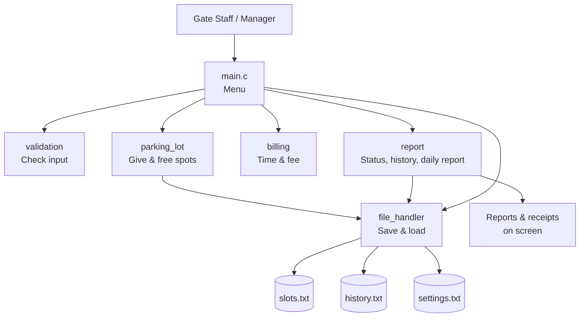
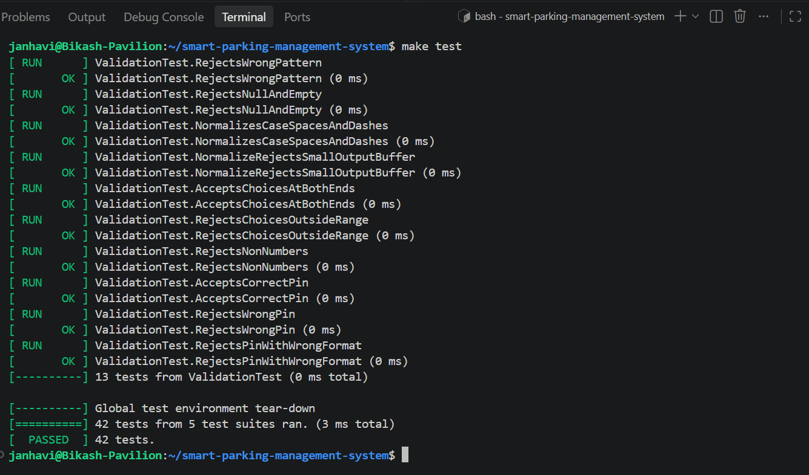
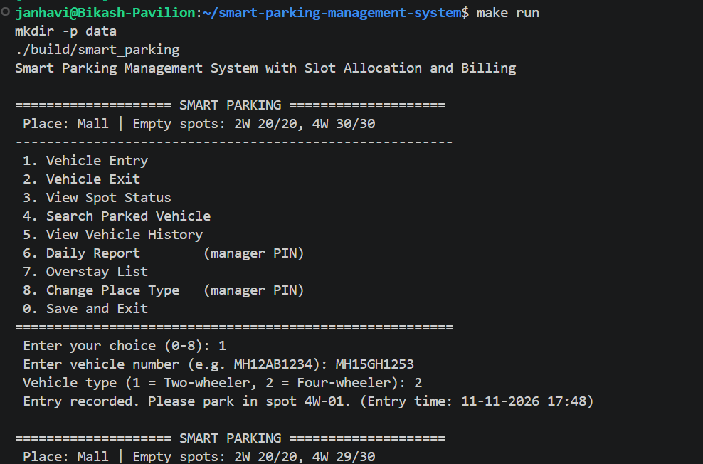
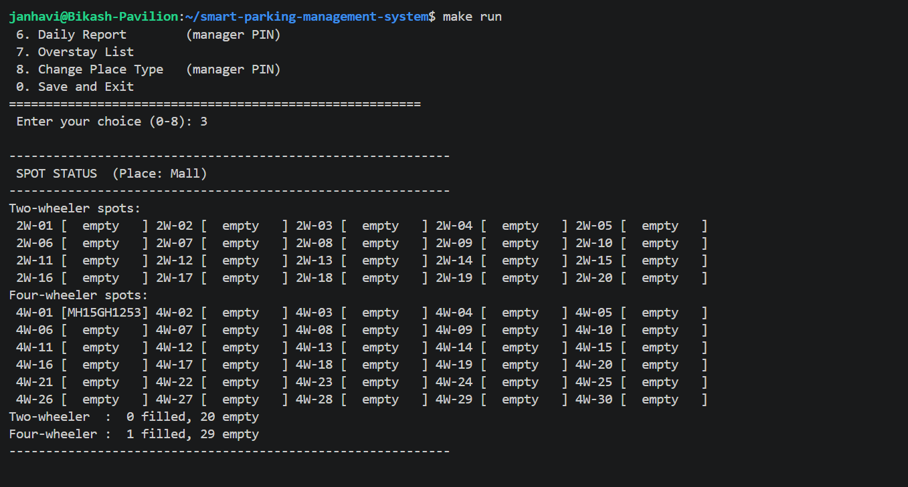

# Smart Parking Management System with Slot Allocation and Billing

A menu-driven C program for a paid parking lot. It gives each vehicle an empty spot at the entry gate, notes the entry and exit times, works out the fee using rules that suit the type of place (Mall, Supermarket, Office or Event), saves all data in text files, and shows useful reports.

**Engineering domain:** Automotive / Transportation

| Field | Details |
|-------|---------|
| Student name | Janhavi Ghose |
| MIS | 612509022 |
| Branch | Instrumentation & Control Engineering |
| Division / batch | Automotive Embedded Batch 1 |
| GitHub repository | https://github.com/JanhaviGhose/Smart-Parking-Management-System |
---

## 1. Problem Statement

In paid parking lots, gate staff and parking managers find it slow and difficult to note down vehicles, find empty spots and calculate fees by hand. This leads to long lines at the gates, wrong fees, spots wrongly shown as filled, and no correct record of how full the lot is or how much money was collected.

## 2. Proposed Solution

This program automatically gives each vehicle an empty spot, notes the entry and exit times, works out the fee using fixed rules, saves all data in files and shows simple reports. Staff can handle vehicles faster, always charge the correct fee, and see correct information about the lot at any time.

A special feature is that **the fee rules depend on the type of place**, so the parking lot encourages the right behaviour:

| Rule (2W / 4W) | Mall | Supermarket | Office | Event / Pandal |
|------|------|-------------|--------|-------|
| Free time | 15 min | 30 min | 10 min | none |
| First charge covers | 2 hours | 1 hour | 1 hour | 3 hours |
| First charge | ₹20 / ₹40 | ₹10 / ₹30 | ₹10 / ₹30 | ₹30 / ₹60 |
| Each extra hour (or part) | ₹10 / ₹20 | ₹20 / ₹50 | ₹15 / ₹40 | ₹30 / ₹60 |
| Maximum per day | ₹80 / ₹200 | ₹150 / ₹400 | ₹100 / ₹300 | ₹300 / ₹600 |
| "Parked too long" after | 12 h | 4 h | 10 h | 6 h |

- **Mall:** cheap long stays so people shop longer.
- **Supermarket:** free for a normal shopping trip, then the price rises fast so spots are free for the next shopper.
- **Office:** fair visitor rate; all-day parking is flagged.
- **Event:** one flat charge for the event; staying longer costs a lot.

## 3. Features

- First-time setup: the manager chooses the type of place
- 20 two-wheeler spots and 30 four-wheeler spots
- Vehicle number check (Indian format, e.g. `MH12AB1234`, `MH12A1234`); spaces, dashes and small letters are accepted and cleaned
- Vehicle entry: first empty spot of the right type; the same vehicle cannot enter twice
- Vehicle exit: time parked, fee, payment confirmation, receipt
- Spot status for the whole lot
- Search a parked vehicle (with time parked and fee so far)
- Past visits of a vehicle
- Daily report: entries, exits, money collected (by vehicle type), average time parked — **manager PIN**
- List of vehicles parked too long
- Change place type (only when the lot is empty) — **manager PIN**
- All data saved in text files; nothing is lost when the program is closed
- Wrong input never crashes the program

## 4. Functional Requirements Summary

| ID | Requirement |
|----|-------------|
| FR-01 | Load saved spot details at start-up |
| FR-02 | Check vehicle number format |
| FR-03 | Give the first empty spot of the right type and note the entry time |
| FR-04 | Refuse a vehicle that is already parked |
| FR-05 | Tell the staff when no spot is free |
| FR-06 | Find the vehicle's spot at exit and note the exit time |
| FR-07 | Work out time parked |
| FR-08 | Work out the fee using the place and vehicle type |
| FR-09 | Free the spot and save the visit after payment |
| FR-10 | Show spot status |
| FR-11 | Search a parked vehicle |
| FR-12 | Show past visits of a vehicle |
| FR-13 | Show the daily report |
| FR-14 | List vehicles parked too long |
| FR-15 | Save spot details after every change |
| FR-16 | Refuse wrong input with a clear message |
| FR-17 | Choose and save the place type |
| FR-18 | Allow place change only when the lot is empty |
| FR-19 | Ask for the manager PIN before manager-only options |

Full details: [`docs/project_proposal.md`](docs/project_proposal.md).

## 5. Software Architecture



Full design: [`docs/detailed_design.md`](docs/detailed_design.md).

## 6. Module Descriptions

| Module | Files | Job |
|--------|-------|-----|
| Main application | `src/main.c` | Start-up, menu, calls other modules, messages, save on exit |
| Common definitions | `include/common.h` | Shared structs, enums, status codes and constants |
| Validation | `src/validation.c`, `include/validation.h` | Cleans and checks vehicle numbers, menu choices, Y/N answers, PIN |
| Parking lot | `src/parking_lot.c`, `include/parking_lot.h` | Sets up spots; gives, finds and frees spots; counts; changes place |
| Billing | `src/billing.c`, `include/billing.h` | Fee table for the 4 places; time parked; fee; overstay check |
| File handler | `src/file_handler.c`, `include/file_handler.h` | Saves and loads settings, spots and history; safe saving |
| Report | `src/report.c`, `include/report.h` | Daily totals, overstay list, printing of status, receipts and reports |

## 7. Folder Structure

```
smart-parking-management-system/
├── src/
│   ├── main.c
│   ├── validation.c
│   ├── parking_lot.c
│   ├── billing.c
│   ├── file_handler.c
│   └── report.c
├── include/
│   ├── common.h
│   ├── validation.h
│   ├── parking_lot.h
│   ├── billing.h
│   ├── file_handler.h
│   └── report.h
├── tests/
│   ├── test_validation.cpp
│   ├── test_billing.cpp
│   ├── test_parking_lot.cpp
│   ├── test_file_handler.cpp
│   └── test_report.cpp
├── data/
│   └── sample_history.txt
├── docs/
│   ├── project_proposal.md
│   └── detailed_design.md
├── Makefile
├── README.md
├── .gitignore
└── LICENSE
```

## 8. C Concepts Used

| Concept | Where |
|---------|-------|
| Structures | `ParkingSlot_t`, `ParkingLot_t`, `ParkingRecord_t`, `FeeRule_t`, `DailySummary_t` |
| Enumerations | `PlaceType_t`, `VehicleType_t`, `SlotStatus_t`, `Status_t` |
| Arrays | 50 spots in `ParkingLot_t`; fee table `FEE_RULES[]`; history records |
| Strings | Vehicle numbers and spot names (`<string.h>`) |
| Pointers | Structs passed by pointer; output parameters |
| Constants | `#define` for spot counts, sizes, PIN, file names; fee table |
| File handling | `fopen`, `fgets`, `sscanf`, `fprintf`, `fclose`, `rename`, `remove` |
| Time | `time`, `difftime`, `localtime`, `strftime`, `mktime` (tests) |
| Status codes | Every function that can fail returns `Status_t` |

Dynamic memory (`malloc`) is not used because the number of spots is fixed.

## 9. Coding Standards Followed

- Four spaces for indentation, no tabs; braces on their own line; one statement per line
- Function names describe actions (`allocateSlot`, `calculateFee`); constants in UPPER_CASE; types end in `_t`
- Header guards in every header; only public functions in headers; C linkage (`extern "C"`) for gTest
- No global variables; helper functions are `static`
- No magic numbers — named constants are used
- Every pointer argument is checked; return values are never ignored
- Only safe input (`fgets`) is used — no `gets()` or `scanf("%s")`
- Functions that work things out never print; printing functions never work things out
- Compiles with `-Wall -Wextra -Wpedantic` and **no warnings**

## 10. Prerequisites

Linux, or Windows with **WSL (Ubuntu)**. Install the tools:

```bash
sudo apt update
sudo apt install build-essential git libgtest-dev cmake
```

## 11. Build, Run and Test

```bash
git clone https://github.com/JanhaviGhose/Smart-Parking-Management-System.git
cd Smart-Parking-Management-System

make all     # build the program  -> build/smart_parking
make run     # build and run the program
make test    # build and run the 42 unit tests
make clean   # remove all generated files
```

On the first run, the program asks the manager to choose the type of place. The choice is saved in `data/settings.txt`.

**Manager PIN:** `4321` (for Daily Report and Change Place Type).

## 12. Sample Input and Output

**Vehicle entry:**
```
 Enter your choice (0-8): 1
 Enter vehicle number (e.g. MH12AB1234): mh 12-ab 1234
 Vehicle type (1 = Two-wheeler, 2 = Four-wheeler): 2
 Entry recorded. Please park in spot 4W-01. (Entry time: 11-11-2026 12:11)
```

**Vehicle exit (after 3 h 20 min at a Mall):**
```
 Enter your choice (0-8): 2
 Enter vehicle number (e.g. MH12AB1234): MH12AB1234
 Spot 4W-01 | Time parked: 3h 20m | Fee: Rs. 80
 Payment received? (Y/N): y

------------------------------------------------------------
 PARKING RECEIPT
------------------------------------------------------------
 Vehicle number : MH12AB1234
 Vehicle type   : Four-wheeler
 Spot           : 4W-01
 Entry time     : 11-11-2026 12:11
 Exit time      : 11-11-2026 15:31
 Time parked    : 3h 20m
 Fee paid       : Rs. 80
------------------------------------------------------------
```

**Wrong input:**
```
 Enter your choice (0-8): abc
 Invalid choice. Please enter a number from 0 to 8.
 Enter your choice (0-8): 1
 Enter vehicle number (e.g. MH12AB1234): MH1AB12
 Invalid vehicle number. Example: MH12AB1234 or MH12A1234.
```

**Daily report:**
```
 DAILY REPORT  (11-11-2026)
 Vehicles entered      : 3
 Vehicles exited       : 3
 Total money collected : Rs. 140
   from two-wheelers   : Rs. 20
   from four-wheelers  : Rs. 120
 Average time parked   : 1h 57m
```

Sample history data: [`data/sample_history.txt`](data/sample_history.txt).

## 13. Unit Testing Summary

Tests use **Google Test** and run with `make test`. They use fixed times (not the real clock) and their own temporary files, so results are always the same and real data is never touched.

| Test file | Module | Tests |
|-----------|--------|-------|
| `test_validation.cpp` | validation | 13 (UT-01 – UT-13) |
| `test_billing.cpp` | billing | 12 (UT-14 – UT-25) |
| `test_parking_lot.cpp` | parking_lot | 10 (UT-26 – UT-35) |
| `test_file_handler.cpp` | file_handler | 4 (UT-36 – UT-39) |
| `test_report.cpp` | report / overstay | 3 (UT-40 – UT-42) |
| **Total** | | **42** |

They include **positive** tests (correct input), **negative** tests (wrong input) and **boundary** tests — for example a car at a Mall for exactly 120 minutes pays ₹40, and at 121 minutes pays ₹60. Full test plan: `docs/detailed_design.md`, section 13.

## 14. Error-Handling Summary

- Every function that can fail returns a `Status_t` code; every pointer is checked for `NULL`
- Wrong input shows a clear message and asks again — the program never crashes
- Long input lines are safely thrown away; sudden end of input saves data and exits
- Missing settings file → first-time setup; missing spot file → start with empty lot
- Damaged spot file → kept as `data/slots_damaged.txt`, program starts with an empty lot
- Damaged history lines are skipped and counted
- Spot data is saved to a temporary file first and then renamed, so a crash cannot damage it
- No division by zero in the daily report when there are no exits

## 15. Known Limitations

- The manager PIN is fixed in the program and is shown while typing; it is not real security
- Only one parking lot and one user at a time
- Payment is only confirmed by the staff; no online or card payment
- Times come from the computer clock, which must be correct
- Only the latest 1000 history records are used for reports

## 16. Future Enhancements

- Real user accounts with hidden passwords
- Monthly passes and discounts
- Number-plate recognition with a camera
- Online / UPI payment
- Reports for any chosen date or month
- Reserved spots (EV charging, disabled access)
- Manager can edit fee rates from the program

## 17. License

MIT License — see [`LICENSE`](LICENSE).

## 18. Screenshots

**All 42 unit tests passing (`make test`):**



**Vehicle entry from the main menu (`make run`):**



**Spot status after the vehicle entered:**


