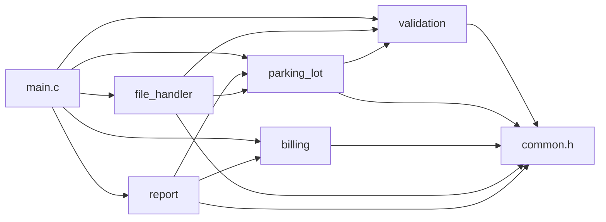
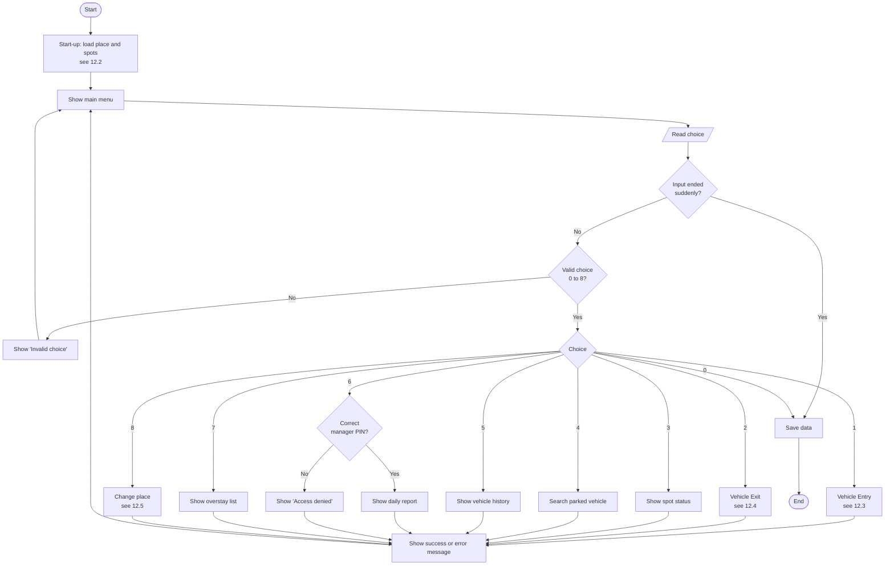
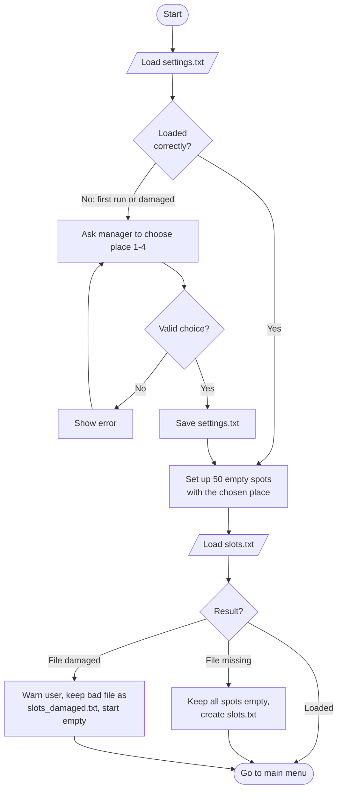
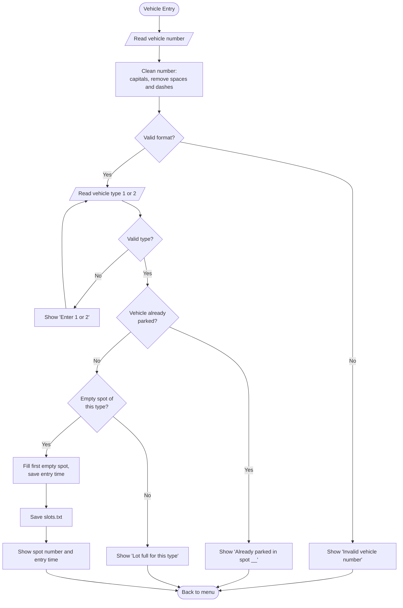
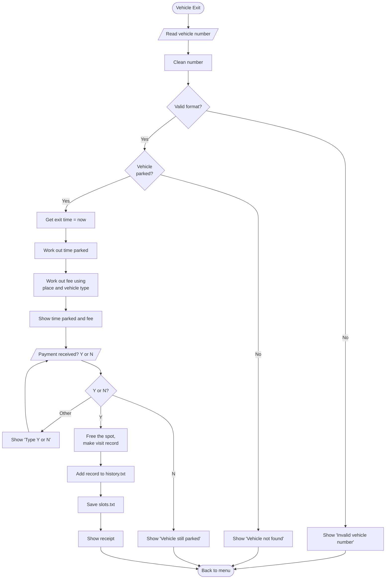
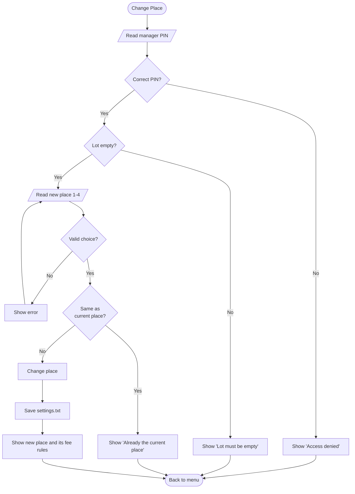

# Detailed Design: Smart Parking Management System with Slot Allocation and Billing

> Phase 2 – C Programming and Software Engineering Mini Project
>
> Section numbers follow the course template. Requirements (FR-XX) are listed in `docs/project_proposal.md`.

---

## 6. Module Design

The program is split into **modules**. Each module is one `.c` file (the code) and one `.h` file (the list of functions other files may use). Each module does one job.

### 6.1 Module Summary

| Module Name | Source File | Header File | Responsibility |
|-------------|-------------|-------------|----------------|
| Main application | main.c | Not applicable | Controls the high-level application flow: start, load data, show menu, call other modules, save, exit |
| Common definitions | – | common.h | Shared structs, enums, status codes and constants |
| Validation | validation.c | validation.h | Checks and cleans everything the user types |
| Parking lot | parking_lot.c | parking_lot.h | Manages the spots: give, find, free, count, change place |
| Billing | billing.c | billing.h | Keeps the fee rules; works out time parked and fee |
| File handler | file_handler.c | file_handler.h | Saves and loads settings, spots and history |
| Report | report.c | report.h | Makes daily totals and overstay lists; prints status, history, receipts and reports |

**Who uses whom (dependencies):**



### 6.2 Detailed Module Description

#### Module: Main application

- **Source file:** main.c
- **Header file:** none
- **Purpose:** The "front desk" of the program. It talks to the user and calls the other modules. It does **not** do any calculations itself.
- **Responsibilities:**
  - Start the program and load the saved place, spots and history
  - On the first run, ask the manager to choose the place
  - Show the menu, read the choice and call the matching module
  - Ask for the manager PIN before manager-only options
  - Show success or error messages
  - Save data after every change and before exiting
- **Functions (only used inside main.c):** `readLine()`, `handleVehicleEntry()`, `handleVehicleExit()`, `handleSlotStatus()`, `handleSearchVehicle()`, `handleVehicleHistory()`, `handleDailyReport()`, `handleOverstayList()`, `handleChangePlace()`, `printStatusMessage()`
- **Data used:** one `ParkingLot_t` variable (the whole parking lot)
- **Depends on:** validation, parking_lot, billing, file_handler, report
- **Possible errors:** shows the message for any status code returned by other modules

#### Module: Validation

- **Source file:** validation.c
- **Header file:** validation.h
- **Purpose:** Makes sure everything the user types is correct **before** it is used.
- **Responsibilities:**
  - Clean up a vehicle number (make it uppercase, remove spaces and dashes)
  - Check that a vehicle number has the correct Indian format
  - Turn the typed menu choice into a number and check it is in range
  - Check yes/no answers
  - Check the manager PIN
- **Public functions:** `normalizeVehicleNumber()`, `isValidVehicleNumber()`, `parseMenuChoice()`, `parseYesNo()`, `isValidManagerPin()`
- **Data used:** only the text passed in
- **Depends on:** common.h
- **Possible errors:** STATUS_NULL_POINTER, STATUS_INVALID_INPUT

#### Module: Parking lot

- **Source file:** parking_lot.c
- **Header file:** parking_lot.h
- **Purpose:** Manages all the parking spots.
- **Responsibilities:**
  - Set up 20 two-wheeler and 30 four-wheeler spots
  - Give the first empty spot of the right type to a vehicle
  - Stop the same vehicle from entering twice
  - Find which spot a vehicle is in
  - Free a spot and create the visit record
  - Count empty and filled spots
  - Change the place type only when the lot is empty
- **Public functions:** `initParkingLot()`, `allocateSlot()`, `findVehicleSlot()`, `releaseSlot()`, `countSlots()`, `isLotEmpty()`, `changePlaceType()`
- **Data used:** `ParkingLot_t`, `ParkingSlot_t`, `ParkingRecord_t`
- **Depends on:** validation, common.h
- **Possible errors:** STATUS_NULL_POINTER, STATUS_INVALID_INPUT, STATUS_DUPLICATE_VEHICLE, STATUS_LOT_FULL, STATUS_NOT_FOUND, STATUS_LOT_NOT_EMPTY

#### Module: Billing

- **Source file:** billing.c
- **Header file:** billing.h
- **Purpose:** Everything to do with time and money.
- **Responsibilities:**
  - Keep the fixed fee table for the 4 places
  - Work out how many minutes a vehicle was parked
  - Work out the fee using the rules of the chosen place
  - Decide if a vehicle has been parked too long
- **Public functions:** `getFeeRule()`, `calculateDurationMinutes()`, `calculateFee()`, `isOverstay()`, `getPlaceName()`, `getVehicleTypeName()`
- **Data used:** the fee table `FEE_RULES[]` (kept inside billing.c only), `FeeRule_t`
- **Depends on:** common.h
- **Possible errors:** STATUS_NULL_POINTER, STATUS_INVALID_INPUT

#### Module: File handler

- **Source file:** file_handler.c
- **Header file:** file_handler.h
- **Purpose:** Saves data to files and loads it back, so nothing is lost when the program closes.
- **Responsibilities:**
  - Save and load the chosen place (settings.txt)
  - Save and load all spot details (slots.txt)
  - Add a finished visit to the history (history.txt)
  - Load history records for reports
  - Check every file action and report problems
- **Public functions:** `loadSettings()`, `saveSettings()`, `loadSlots()`, `saveSlots()`, `appendHistoryRecord()`, `loadHistory()`
- **Data used:** `ParkingLot_t`, `ParkingRecord_t`, `PlaceType_t`
- **Depends on:** parking_lot (to set up a fresh lot), validation (to check vehicle numbers in files), common.h
- **Possible errors:** STATUS_NULL_POINTER, STATUS_FILE_ERROR, STATUS_INVALID_FILE_DATA, STATUS_HISTORY_FULL

Every file function takes the **file name as an input**. In the real program we pass the real file names; in tests we pass test file names, so tests never touch the real data.

#### Module: Report

- **Source file:** report.c
- **Header file:** report.h
- **Purpose:** Turns stored data into useful information for the staff and manager.
- **Responsibilities:**
  - Work out the daily totals (entries, exits, money, average time)
  - Find vehicles parked too long
  - Print the spot status, vehicle history, receipt, daily report and overstay list
- **Public functions:** `calculateDailySummary()`, `findOverstayVehicles()`, `printSlotStatus()`, `printVehicleHistory()`, `printReceipt()`, `printDailyReport()`, `printOverstayList()`, `printFeeRules()`, `formatTime()`
- **Data used:** `ParkingLot_t`, `ParkingRecord_t`, `DailySummary_t`
- **Depends on:** billing, parking_lot, common.h
- **Possible errors:** STATUS_NULL_POINTER, STATUS_INVALID_INPUT, STATUS_NOT_FOUND

**Rule followed in every module:** functions that *work things out* (like `calculateFee`) never print anything, and functions that *print* (like `printReceipt`) never work things out. This keeps the working-out functions easy to test.

---

## 7. Data Design

This section describes **what information the program stores** and **how it is stored in C**.

All shared types and fixed values are kept in one header file, `common.h`, so every module uses the same definitions.

### 7.1 Structure Definitions

A **structure (struct)** is like a box that keeps several related pieces of information together under one name.

#### Structure: `ParkingSlot_t`

**Purpose:** Stores the details of **one parking spot**.

```c
typedef struct
{
    char          slotId[SLOT_ID_LEN];               /* e.g. "2W-05" or "4W-12"          */
    VehicleType_t vehicleType;                       /* which vehicles may use this spot */
    SlotStatus_t  status;                            /* empty or filled                  */
    char          vehicleNumber[VEHICLE_NUMBER_LEN]; /* vehicle in the spot ("" if empty) */
    time_t        entryTime;                         /* when the vehicle came in (0 if empty) */
} ParkingSlot_t;
```

| Member | C Type | Valid Range or Size | Description |
|--------|--------|---------------------|-------------|
| slotId | char array | up to 5 characters + end mark | Spot name: "2W-01" to "2W-20", "4W-01" to "4W-30" |
| vehicleType | VehicleType_t | VEHICLE_TWO_WHEELER or VEHICLE_FOUR_WHEELER | Type of vehicle this spot is for |
| status | SlotStatus_t | SLOT_EMPTY or SLOT_FILLED | Whether a vehicle is parked here |
| vehicleNumber | char array | 9 to 10 characters + end mark, or empty | Number of the parked vehicle |
| entryTime | time_t | 0, or a valid time | Time the vehicle entered |

#### Structure: `ParkingLot_t`

**Purpose:** Stores the **whole parking lot**: all spots and the chosen place. Keeping everything in one structure means we don't need global variables (the guidelines ask us to avoid them).

```c
typedef struct
{
    ParkingSlot_t slots[TOTAL_SLOTS]; /* all 50 spots              */
    PlaceType_t   placeType;          /* mall, supermarket, etc.   */
} ParkingLot_t;
```

| Member | C Type | Valid Range or Size | Description |
|--------|--------|---------------------|-------------|
| slots | array of ParkingSlot_t | exactly 50 (TOTAL_SLOTS) | Spots 0–19 are two-wheeler, 20–49 are four-wheeler |
| placeType | PlaceType_t | PLACE_MALL to PLACE_EVENT | The type of place chosen by the manager |

#### Structure: `ParkingRecord_t`

**Purpose:** Stores **one finished visit** (a vehicle that has come in and gone out). These records are saved in the history file.

```c
typedef struct
{
    char          vehicleNumber[VEHICLE_NUMBER_LEN];
    VehicleType_t vehicleType;
    char          slotId[SLOT_ID_LEN];
    time_t        entryTime;
    time_t        exitTime;
    long          durationMinutes;  /* time parked, in minutes */
    int           feeRupees;        /* amount paid             */
} ParkingRecord_t;
```

| Member | C Type | Valid Range or Size | Description |
|--------|--------|---------------------|-------------|
| vehicleNumber | char array | 9 to 10 characters + end mark | Vehicle number |
| vehicleType | VehicleType_t | two-wheeler or four-wheeler | Vehicle type |
| slotId | char array | up to 5 characters + end mark | Spot that was used |
| entryTime | time_t | valid time | Time of entry |
| exitTime | time_t | must be later than or equal to entryTime | Time of exit |
| durationMinutes | long | 0 or more | Time parked in minutes |
| feeRupees | int | 0 or more | Fee paid in rupees |

#### Structure: `FeeRule_t`

**Purpose:** Stores the **fee rules for one place**. The program has a fixed table of four of these, one for each place.

```c
typedef struct
{
    int freeMinutes;                          /* free time before charging starts       */
    int firstBlockHours;                      /* hours covered by the first charge      */
    int firstBlockFee[VEHICLE_TYPE_COUNT];    /* first charge, for 2W and 4W            */
    int extraHourFee[VEHICLE_TYPE_COUNT];     /* charge for every extra hour (or part)  */
    int dailyMaxFee[VEHICLE_TYPE_COUNT];      /* most that can be charged for one day   */
    int overstayLimitHours;                   /* "parked too long" after this many hours */
} FeeRule_t;
```

| Member | C Type | Valid Range or Size | Description |
|--------|--------|---------------------|-------------|
| freeMinutes | int | 0 or more | Free minutes |
| firstBlockHours | int | 1 or more | Hours covered by the first charge |
| firstBlockFee | int array [2] | 0 or more | First charge for 2W and 4W |
| extraHourFee | int array [2] | 0 or more | Charge for each extra hour for 2W and 4W |
| dailyMaxFee | int array [2] | more than first charge | Maximum charge per day for 2W and 4W |
| overstayLimitHours | int | 1 or more | Hours after which a vehicle is "parked too long" |

#### Structure: `DailySummary_t`

**Purpose:** Stores the **totals for the daily report**.

```c
typedef struct
{
    int    entries;                          /* vehicles that came in today          */
    int    exits;                            /* vehicles that left today             */
    int    totalRevenue;                     /* money collected today, in rupees     */
    int    revenueByType[VEHICLE_TYPE_COUNT];/* money from 2W and from 4W            */
    double averageMinutes;                   /* average time parked by vehicles that left */
} DailySummary_t;
```

| Member | C Type | Valid Range or Size | Description |
|--------|--------|---------------------|-------------|
| entries | int | 0 or more | Number of entries today |
| exits | int | 0 or more | Number of exits today |
| totalRevenue | int | 0 or more | Total money today |
| revenueByType | int array [2] | 0 or more | Money from two-wheelers and four-wheelers |
| averageMinutes | double | 0 or more | Average time parked (0 if no exits) |

---

### 7.2 Enumeration Definitions

An **enumeration (enum)** gives names to a fixed set of choices, so the code says `PLACE_MALL` instead of a plain number like `0`.

#### Enumeration: `PlaceType_t`

**Purpose:** The type of place the parking lot is for.

```c
typedef enum
{
    PLACE_MALL = 0,
    PLACE_SUPERMARKET,
    PLACE_OFFICE,
    PLACE_EVENT,
    PLACE_TYPE_COUNT   /* number of places – used for checking and array sizes */
} PlaceType_t;
```

| Enumeration Constant | Meaning |
|----------------------|---------|
| PLACE_MALL | Shopping mall |
| PLACE_SUPERMARKET | Supermarket |
| PLACE_OFFICE | Office |
| PLACE_EVENT | Event or pandal |
| PLACE_TYPE_COUNT | Number of places (4); not a real place |

#### Enumeration: `VehicleType_t`

**Purpose:** The type of vehicle.

```c
typedef enum
{
    VEHICLE_TWO_WHEELER = 0,
    VEHICLE_FOUR_WHEELER,
    VEHICLE_TYPE_COUNT
} VehicleType_t;
```

| Enumeration Constant | Meaning |
|----------------------|---------|
| VEHICLE_TWO_WHEELER | Bike or scooter |
| VEHICLE_FOUR_WHEELER | Car |
| VEHICLE_TYPE_COUNT | Number of vehicle types (2); not a real type |

#### Enumeration: `SlotStatus_t`

**Purpose:** Whether a spot is in use.

```c
typedef enum
{
    SLOT_EMPTY = 0,
    SLOT_FILLED
} SlotStatus_t;
```

| Enumeration Constant | Meaning |
|----------------------|---------|
| SLOT_EMPTY | No vehicle in the spot |
| SLOT_FILLED | A vehicle is parked in the spot |

#### Enumeration: `Status_t`

**Purpose:** The result returned by functions, so the caller knows whether the job worked and, if not, what went wrong.

```c
typedef enum
{
    STATUS_OK = 0,
    STATUS_NULL_POINTER,
    STATUS_INVALID_INPUT,
    STATUS_DUPLICATE_VEHICLE,
    STATUS_LOT_FULL,
    STATUS_NOT_FOUND,
    STATUS_LOT_NOT_EMPTY,
    STATUS_ACCESS_DENIED,
    STATUS_HISTORY_FULL,
    STATUS_FILE_ERROR,
    STATUS_INVALID_FILE_DATA
} Status_t;
```

| Enumeration Constant | Meaning |
|----------------------|---------|
| STATUS_OK | The job worked |
| STATUS_NULL_POINTER | A function was given an empty (NULL) address – a programming mistake |
| STATUS_INVALID_INPUT | The user typed something wrong (bad vehicle number, bad menu choice, etc.) |
| STATUS_DUPLICATE_VEHICLE | This vehicle is already parked |
| STATUS_LOT_FULL | No empty spot for this vehicle type |
| STATUS_NOT_FOUND | The vehicle is not in the parking lot / no records found |
| STATUS_LOT_NOT_EMPTY | The place cannot be changed because vehicles are parked |
| STATUS_ACCESS_DENIED | Wrong manager PIN was entered |
| STATUS_HISTORY_FULL | The history list has reached its maximum size |
| STATUS_FILE_ERROR | A file could not be opened, read or written |
| STATUS_INVALID_FILE_DATA | A file has wrong or damaged data |

---

### 7.3 Constants

Fixed values are written once with a name, instead of plain numbers inside the code. To change a value, we change it in one place.

| Constant | Value | Purpose |
|----------|-------|---------|
| TWO_WHEELER_SLOTS | 20 | Number of two-wheeler spots |
| FOUR_WHEELER_SLOTS | 30 | Number of four-wheeler spots |
| TOTAL_SLOTS | 50 | Total spots (20 + 30) |
| VEHICLE_NUMBER_MIN_LEN | 9 | Shortest valid vehicle number (e.g. MH12A1234) |
| VEHICLE_NUMBER_MAX_LEN | 10 | Longest valid vehicle number (e.g. MH12AB1234) |
| VEHICLE_NUMBER_LEN | 11 | Space needed to store a vehicle number (10 + end mark) |
| SLOT_ID_LEN | 6 | Space needed to store a spot name like "4W-30" (5 + end mark) |
| MAX_HISTORY_RECORDS | 1000 | Most history records read at once for reports |
| MAX_INPUT_LEN | 64 | Longest line the user can type |
| MANAGER_PIN | "4321" | Manager PIN for manager-only options (fixed in the program; not real security – known limitation) |
| PIN_LEN | 4 | Number of digits in the PIN |
| MINUTES_PER_HOUR | 60 | Minutes in one hour |
| MINUTES_PER_DAY | 1440 | Minutes in one day |
| SETTINGS_FILE | "data/settings.txt" | File that stores the chosen place |
| SLOTS_FILE | "data/slots.txt" | File that stores the spot details |
| HISTORY_FILE | "data/history.txt" | File that stores finished visits |

#### Fee rules table

The four places' fee rules are kept in a fixed table, `FEE_RULES[PLACE_TYPE_COUNT]`, inside `billing.c`. Amounts are in rupees, written as two-wheeler / four-wheeler.

| Rule | Mall | Supermarket | Office | Event |
|------|------|-------------|--------|-------|
| freeMinutes | 15 | 30 | 10 | 0 |
| firstBlockHours | 2 | 1 | 1 | 3 |
| firstBlockFee | 20 / 40 | 10 / 30 | 10 / 30 | 30 / 60 |
| extraHourFee | 10 / 20 | 20 / 50 | 15 / 40 | 30 / 60 |
| dailyMaxFee | 80 / 200 | 150 / 400 | 100 / 300 | 300 / 600 |
| overstayLimitHours | 12 | 4 | 10 | 6 |

**Why these numbers:**
- **Mall:** cheap first 2 hours and a low daily maximum, so people stay and shop longer.
- **Supermarket:** 30 free minutes covers a normal shopping trip; after that the price rises fast so spots are free for the next shopper.
- **Office:** a fair rate for visitors; vehicles parked more than 10 hours are flagged.
- **Event:** one flat charge covers 3 hours of the event; staying longer costs a lot, so the parking is not misused.

#### How the fee is worked out

1. If the time parked is **within the free minutes**, the fee is **₹0**.
2. Otherwise, charge the **first charge**.
3. If the time parked is longer than the **first block of hours**, add the **extra-hour charge** for every extra hour. A part of an hour counts as a full hour.
4. The fee for one day can **never be more than the daily maximum**.
5. For stays longer than one day: each full day costs the daily maximum, and the leftover time is charged using steps 1–4.

**Examples (four-wheeler):**

| Place | Time parked | Working | Fee |
|-------|-------------|---------|-----|
| Mall | 10 minutes | within 15 free minutes | ₹0 |
| Mall | 3 h 20 min | ₹40 (first 2 h) + 2 extra hours × ₹20 | ₹80 |
| Supermarket | 3 h 20 min | ₹30 (first 1 h) + 3 extra hours × ₹50 = ₹180 | ₹180 |
| Supermarket | 10 hours | ₹30 + 9 × ₹50 = ₹480, but daily max is ₹400 | ₹400 |
| Event | 5 hours | ₹60 (first 3 h) + 2 extra hours × ₹60 | ₹180 |
| Mall | 1 day 1 hour | 1 full day × ₹200 + ₹40 (leftover 1 h) | ₹240 |

---

### 7.4 Data Dictionary

A list of every important piece of data, its type, its allowed values and how it is checked.

| Data Item | C Type | Valid Range or Size | Validation Rule | Description |
|-----------|--------|---------------------|-----------------|-------------|
| Vehicle number | char[11] | 9–10 characters | 2 letters (state) + 2 digits (district) + 1–2 letters (series) + 4 digits. Lowercase is changed to uppercase; spaces and dashes are removed before checking | Registration number, e.g. MH12AB1234 |
| Vehicle type | VehicleType_t | 2W or 4W | Menu choice must be 1 or 2 | Type of vehicle |
| Place type | PlaceType_t | Mall, Supermarket, Office, Event | Menu choice must be 1 to 4 | Type of place |
| Menu choice | int | 0 to 8 | Must be a whole number in the menu range; anything else is refused | Option chosen by the user |
| Slot ID | char[6] | "2W-01"–"2W-20", "4W-01"–"4W-30" | Created by the program, not typed by the user; checked when loading files | Spot name |
| Slot status | SlotStatus_t | Empty or Filled | Must be 0 or 1 when loaded from file | Whether the spot is in use |
| Entry time | time_t | valid time | Must not be in the future when loaded from file | Time vehicle came in |
| Exit time | time_t | valid time | Must be the same as or later than entry time | Time vehicle left |
| Time parked | long | 0 or more minutes | Must not be negative | Exit time minus entry time |
| Fee | int | 0 or more rupees | Must not be negative | Amount to pay |
| Payment confirmation | char | 'Y' or 'N' | Only Y/y or N/n accepted | Staff confirms the fee was paid |
| Manager PIN (typed) | char[5] | exactly 4 digits | Must be exactly 4 digits and match MANAGER_PIN; otherwise access is refused | PIN typed to open manager-only options |

---

## 8. Function Design

This section describes every **important function** (small job) of the program: what goes in, what comes out, and what can go wrong.

**Words used in this section:**
- **Parameter:** a value given to the function.
- **Direction:** *Input* = the function only reads it. *Output* = the function writes the answer into it. *Input-Output* = the function reads and changes it.
- **Return value:** the result the function gives back. Most functions return a `Status_t` code saying whether the job worked.
- **Precondition:** what must be true **before** the function is called.
- **Postcondition:** what will be true **after** the function finishes successfully.
- **UT-XX:** the number of a planned unit test (details in section 13).

---

### 8.1 Function: `normalizeVehicleNumber`

**Module:** validation

**Prototype:**
```c
Status_t normalizeVehicleNumber(const char *input, char *output, size_t outputSize);
```

**Purpose:** Cleans up a typed vehicle number: changes small letters to capital letters and removes spaces and dashes. Example: `"mh 12-ab 1234"` → `"MH12AB1234"`.

| Parameter | C Type | Direction | Description | Valid Values |
|-----------|--------|-----------|-------------|--------------|
| input | const char * | Input | Text typed by the user | Not NULL |
| output | char * | Output | Cleaned vehicle number | Not NULL |
| outputSize | size_t | Input | Space available in output | VEHICLE_NUMBER_LEN or more |

**Return type:** Status_t

| Return Value | Meaning |
|--------------|---------|
| STATUS_OK | Cleaned successfully |
| STATUS_NULL_POINTER | input or output is NULL |
| STATUS_INVALID_INPUT | Cleaned text is empty or too long for output |

**Preconditions:** input is a proper text string.
**Postconditions:** output holds only capital letters and digits.
**Errors handled:** NULL pointers, empty input, text too long.
**Related requirements:** FR-02
**Planned unit tests:** UT-06, UT-07

---

### 8.2 Function: `isValidVehicleNumber`

**Module:** validation

**Prototype:**
```c
bool isValidVehicleNumber(const char *vehicleNumber);
```

**Purpose:** Checks if an (already cleaned) vehicle number has the Indian format: 2 letters + 2 digits + 1 or 2 letters + 4 digits. Example: `MH12AB1234` ✔, `MH12A1234` ✔, `MH1AB1234` ✘.

| Parameter | C Type | Direction | Description | Valid Values |
|-----------|--------|-----------|-------------|--------------|
| vehicleNumber | const char * | Input | Cleaned vehicle number | Any text, or NULL |

**Return type:** bool

| Return Value | Meaning |
|--------------|---------|
| true | Format is correct |
| false | Format is wrong, or vehicleNumber is NULL |

**Preconditions:** none (NULL is handled).
**Postconditions:** the input is not changed.
**Errors handled:** NULL, empty text, wrong length, letters where digits should be and the other way round.
**Related requirements:** FR-02
**Planned unit tests:** UT-01, UT-02, UT-03, UT-04, UT-05

---

### 8.3 Function: `parseMenuChoice`

**Module:** validation

**Prototype:**
```c
Status_t parseMenuChoice(const char *input, int minChoice, int maxChoice, int *choice);
```

**Purpose:** Turns the typed menu choice (text) into a number and checks it is between minChoice and maxChoice. Also used for choosing the place (1–4) and vehicle type (1–2).

| Parameter | C Type | Direction | Description | Valid Values |
|-----------|--------|-----------|-------------|--------------|
| input | const char * | Input | Text typed by the user | Not NULL |
| minChoice | int | Input | Smallest allowed number | ≤ maxChoice |
| maxChoice | int | Input | Largest allowed number | ≥ minChoice |
| choice | int * | Output | The number chosen | Not NULL |

**Return type:** Status_t

| Return Value | Meaning |
|--------------|---------|
| STATUS_OK | choice holds a valid number |
| STATUS_NULL_POINTER | input or choice is NULL |
| STATUS_INVALID_INPUT | Not a whole number, has extra characters, or out of range |

**Preconditions:** minChoice ≤ maxChoice.
**Postconditions:** on success, minChoice ≤ *choice ≤ maxChoice.
**Errors handled:** empty input, letters, decimals, extra characters ("3abc"), out-of-range numbers.
**Related requirements:** FR-16
**Planned unit tests:** UT-08, UT-09, UT-10

---

### 8.4 Function: `isValidManagerPin`

**Module:** validation

**Prototype:**
```c
bool isValidManagerPin(const char *pin);
```

**Purpose:** Checks that the typed PIN is exactly 4 digits and matches MANAGER_PIN.

| Parameter | C Type | Direction | Description | Valid Values |
|-----------|--------|-----------|-------------|--------------|
| pin | const char * | Input | PIN typed by the user | Any text, or NULL |

**Return type:** bool

| Return Value | Meaning |
|--------------|---------|
| true | PIN is correct |
| false | PIN is wrong, wrong length, or NULL |

**Preconditions:** none.
**Postconditions:** the input is not changed.
**Errors handled:** NULL, wrong length, non-digits, wrong PIN.
**Related requirements:** FR-19
**Planned unit tests:** UT-11, UT-12, UT-13

---

### 8.5 Function: `initParkingLot`

**Module:** parking_lot

**Prototype:**
```c
Status_t initParkingLot(ParkingLot_t *lot, PlaceType_t placeType);
```

**Purpose:** Sets up a fresh parking lot: names all 50 spots ("2W-01"… "4W-30"), sets their type, marks them all empty, and stores the place type.

| Parameter | C Type | Direction | Description | Valid Values |
|-----------|--------|-----------|-------------|--------------|
| lot | ParkingLot_t * | Output | Parking lot to set up | Not NULL |
| placeType | PlaceType_t | Input | Chosen place | PLACE_MALL to PLACE_EVENT |

**Return type:** Status_t

| Return Value | Meaning |
|--------------|---------|
| STATUS_OK | Lot set up |
| STATUS_NULL_POINTER | lot is NULL |
| STATUS_INVALID_INPUT | placeType is not a real place |

**Preconditions:** none.
**Postconditions:** spots 0–19 are empty two-wheeler spots, spots 20–49 are empty four-wheeler spots.
**Errors handled:** NULL pointer, invalid place.
**Related requirements:** FR-01, FR-17
**Planned unit tests:** UT-26 (used to prepare the lot)

---

### 8.6 Function: `allocateSlot`

**Module:** parking_lot

**Prototype:**
```c
Status_t allocateSlot(ParkingLot_t *lot, const char *vehicleNumber,
                      VehicleType_t vehicleType, time_t entryTime, int *slotIndex);
```

**Purpose:** Gives the **first empty spot of the right type** to an entering vehicle and saves the vehicle number and entry time in that spot.

| Parameter | C Type | Direction | Description | Valid Values |
|-----------|--------|-----------|-------------|--------------|
| lot | ParkingLot_t * | Input-Output | The parking lot | Not NULL |
| vehicleNumber | const char * | Input | Cleaned vehicle number | Valid format |
| vehicleType | VehicleType_t | Input | Vehicle type | 2W or 4W |
| entryTime | time_t | Input | Time of entry | Valid time |
| slotIndex | int * | Output | Position of the spot given | Not NULL |

**Return type:** Status_t

| Return Value | Meaning |
|--------------|---------|
| STATUS_OK | Spot given; slotIndex holds its position |
| STATUS_NULL_POINTER | lot, vehicleNumber or slotIndex is NULL |
| STATUS_INVALID_INPUT | Wrong vehicle number format or wrong vehicle type |
| STATUS_DUPLICATE_VEHICLE | This vehicle is already parked |
| STATUS_LOT_FULL | No empty spot of this type |

**Preconditions:** lot has been set up.
**Postconditions:** on success, the spot is filled with this vehicle and entry time; nothing else changes. On failure, nothing changes.
**Errors handled:** NULL pointers, bad number, bad type, duplicate vehicle, full lot.
**Related requirements:** FR-03, FR-04, FR-05
**Planned unit tests:** UT-26, UT-27, UT-28, UT-29

---

### 8.7 Function: `findVehicleSlot`

**Module:** parking_lot

**Prototype:**
```c
Status_t findVehicleSlot(const ParkingLot_t *lot, const char *vehicleNumber, int *slotIndex);
```

**Purpose:** Finds the spot where a vehicle is parked.

| Parameter | C Type | Direction | Description | Valid Values |
|-----------|--------|-----------|-------------|--------------|
| lot | const ParkingLot_t * | Input | The parking lot | Not NULL |
| vehicleNumber | const char * | Input | Vehicle to look for | Not NULL |
| slotIndex | int * | Output | Position of the spot found | Not NULL |

**Return type:** Status_t

| Return Value | Meaning |
|--------------|---------|
| STATUS_OK | Found; slotIndex holds the position |
| STATUS_NULL_POINTER | A pointer is NULL |
| STATUS_NOT_FOUND | This vehicle is not parked |

**Preconditions:** lot has been set up.
**Postconditions:** the lot is not changed.
**Errors handled:** NULL pointers, vehicle not found.
**Related requirements:** FR-04, FR-06, FR-11
**Planned unit tests:** UT-30, UT-31

---

### 8.8 Function: `releaseSlot`

**Module:** parking_lot

**Prototype:**
```c
Status_t releaseSlot(ParkingLot_t *lot, int slotIndex, time_t exitTime,
                     long durationMinutes, int feeRupees, ParkingRecord_t *record);
```

**Purpose:** After payment, fills in the visit record (vehicle, spot, times, fee) and makes the spot empty again.

| Parameter | C Type | Direction | Description | Valid Values |
|-----------|--------|-----------|-------------|--------------|
| lot | ParkingLot_t * | Input-Output | The parking lot | Not NULL |
| slotIndex | int | Input | Spot to free | 0 to TOTAL_SLOTS − 1 |
| exitTime | time_t | Input | Time of exit | ≥ entry time |
| durationMinutes | long | Input | Time parked | 0 or more |
| feeRupees | int | Input | Fee paid | 0 or more |
| record | ParkingRecord_t * | Output | Finished visit record | Not NULL |

**Return type:** Status_t

| Return Value | Meaning |
|--------------|---------|
| STATUS_OK | Record filled, spot freed |
| STATUS_NULL_POINTER | lot or record is NULL |
| STATUS_INVALID_INPUT | slotIndex out of range, spot already empty, negative values, or exit before entry |

**Preconditions:** the spot is filled; payment has been confirmed.
**Postconditions:** the spot is empty; record holds the full visit details.
**Errors handled:** NULL pointers, bad index, spot already empty, bad values.
**Related requirements:** FR-09
**Planned unit tests:** UT-32, UT-33

---

### 8.9 Function: `changePlaceType`

**Module:** parking_lot

**Prototype:**
```c
Status_t changePlaceType(ParkingLot_t *lot, PlaceType_t newPlaceType);
```

**Purpose:** Changes the place type, but **only if no vehicle is parked**.

| Parameter | C Type | Direction | Description | Valid Values |
|-----------|--------|-----------|-------------|--------------|
| lot | ParkingLot_t * | Input-Output | The parking lot | Not NULL |
| newPlaceType | PlaceType_t | Input | New place | PLACE_MALL to PLACE_EVENT |

**Return type:** Status_t

| Return Value | Meaning |
|--------------|---------|
| STATUS_OK | Place changed |
| STATUS_NULL_POINTER | lot is NULL |
| STATUS_INVALID_INPUT | newPlaceType is not a real place |
| STATUS_LOT_NOT_EMPTY | Vehicles are parked, so the place was not changed |

**Preconditions:** the manager PIN has already been checked by main.c.
**Postconditions:** on success, lot->placeType is the new place.
**Errors handled:** NULL pointer, bad place, lot not empty.
**Related requirements:** FR-17, FR-18
**Planned unit tests:** UT-34, UT-35

---

### 8.10 Function: `calculateDurationMinutes`

**Module:** billing

**Prototype:**
```c
Status_t calculateDurationMinutes(time_t entryTime, time_t exitTime, long *minutes);
```

**Purpose:** Works out how many whole minutes a vehicle was parked. Works correctly even if the stay goes past midnight.

| Parameter | C Type | Direction | Description | Valid Values |
|-----------|--------|-----------|-------------|--------------|
| entryTime | time_t | Input | Time of entry | Valid time |
| exitTime | time_t | Input | Time of exit | ≥ entryTime |
| minutes | long * | Output | Time parked in minutes | Not NULL |

**Return type:** Status_t

| Return Value | Meaning |
|--------------|---------|
| STATUS_OK | minutes holds the time parked |
| STATUS_NULL_POINTER | minutes is NULL |
| STATUS_INVALID_INPUT | exitTime is before entryTime |

**Preconditions:** none.
**Postconditions:** *minutes ≥ 0. Leftover seconds are rounded up to the next minute (e.g. 61 seconds = 2 minutes).
**Errors handled:** NULL pointer, exit before entry.
**Related requirements:** FR-07
**Planned unit tests:** UT-23, UT-24, UT-25

---

### 8.11 Function: `calculateFee`

**Module:** billing

**Prototype:**
```c
Status_t calculateFee(PlaceType_t placeType, VehicleType_t vehicleType,
                      long durationMinutes, int *feeRupees);
```

**Purpose:** Works out the fee using the fee rules of the chosen place (see section 7.3, "How the fee is worked out").

| Parameter | C Type | Direction | Description | Valid Values |
|-----------|--------|-----------|-------------|--------------|
| placeType | PlaceType_t | Input | Chosen place | PLACE_MALL to PLACE_EVENT |
| vehicleType | VehicleType_t | Input | Vehicle type | 2W or 4W |
| durationMinutes | long | Input | Time parked | 0 or more |
| feeRupees | int * | Output | Fee to pay | Not NULL |

**Return type:** Status_t

| Return Value | Meaning |
|--------------|---------|
| STATUS_OK | feeRupees holds the fee |
| STATUS_NULL_POINTER | feeRupees is NULL |
| STATUS_INVALID_INPUT | Bad place, bad vehicle type, or negative time |

**Preconditions:** none.
**Postconditions:** *feeRupees ≥ 0, and the fee for any one day is never more than the daily maximum.
**Errors handled:** NULL pointer, bad place, bad type, negative time.
**Related requirements:** FR-08
**Planned unit tests:** UT-14, UT-15, UT-16, UT-17, UT-18, UT-19, UT-20, UT-21, UT-22

---

### 8.12 Function: `isOverstay`

**Module:** billing

**Prototype:**
```c
bool isOverstay(PlaceType_t placeType, long durationMinutes);
```

**Purpose:** Says whether a vehicle has been parked longer than the "parked too long" limit of the chosen place.

| Parameter | C Type | Direction | Description | Valid Values |
|-----------|--------|-----------|-------------|--------------|
| placeType | PlaceType_t | Input | Chosen place | PLACE_MALL to PLACE_EVENT |
| durationMinutes | long | Input | Time parked so far | 0 or more |

**Return type:** bool

| Return Value | Meaning |
|--------------|---------|
| true | Parked longer than the limit |
| false | Within the limit, or bad input |

**Preconditions:** none.
**Postconditions:** nothing is changed.
**Errors handled:** bad place, negative time (returns false).
**Related requirements:** FR-14
**Planned unit tests:** UT-42

---

### 8.13 Functions: `saveSlots` and `loadSlots`

**Module:** file_handler

**Prototypes:**
```c
Status_t saveSlots(const char *fileName, const ParkingLot_t *lot);
Status_t loadSlots(const char *fileName, ParkingLot_t *lot);
```

**Purpose:** `saveSlots` writes every spot to the file, one line per spot. `loadSlots` reads them back into the lot.

| Parameter | C Type | Direction | Description | Valid Values |
|-----------|--------|-----------|-------------|--------------|
| fileName | const char * | Input | File to use | Not NULL |
| lot | ParkingLot_t * | Input (save) / Output (load) | The parking lot | Not NULL |

**Return type:** Status_t

| Return Value | Meaning |
|--------------|---------|
| STATUS_OK | Saved / loaded |
| STATUS_NULL_POINTER | A pointer is NULL |
| STATUS_FILE_ERROR | File could not be opened, read or written |
| STATUS_INVALID_FILE_DATA | A line in the file is damaged or has wrong values (load only) |

**Preconditions:** for load, the lot has been set up with initParkingLot.
**Postconditions:** after save, the file matches the lot. After a successful load, the lot matches the file. If loading fails, the lot is left as a fresh empty lot.
**Errors handled:** NULL pointers, missing file, damaged lines, wrong counts, invalid values.
**Related requirements:** FR-01, FR-15
**Planned unit tests:** UT-36, UT-37, UT-38

---

### 8.14 Functions: `appendHistoryRecord` and `loadHistory`

**Module:** file_handler

**Prototypes:**
```c
Status_t appendHistoryRecord(const char *fileName, const ParkingRecord_t *record);
Status_t loadHistory(const char *fileName, ParkingRecord_t records[],
                     int maxRecords, int *count, int *skippedLines);
```

**Purpose:** `appendHistoryRecord` adds one finished visit to the end of the history file. `loadHistory` reads the visits into an array for reports.

| Parameter | C Type | Direction | Description | Valid Values |
|-----------|--------|-----------|-------------|--------------|
| fileName | const char * | Input | History file | Not NULL |
| record | const ParkingRecord_t * | Input | Visit to add | Not NULL |
| records | ParkingRecord_t [] | Output | Array to fill | Not NULL |
| maxRecords | int | Input | Size of the array | 1 or more |
| count | int * | Output | Number of records read | Not NULL |
| skippedLines | int * | Output | Number of damaged lines skipped | May be NULL |

**Return type:** Status_t

| Return Value | Meaning |
|--------------|---------|
| STATUS_OK | Added / loaded (a missing history file counts as 0 records) |
| STATUS_NULL_POINTER | A pointer is NULL |
| STATUS_FILE_ERROR | File could not be written |
| STATUS_HISTORY_FULL | More records than maxRecords; only the most recent maxRecords are kept |

**Preconditions:** none.
**Postconditions:** damaged lines are skipped and counted, not loaded.
**Errors handled:** NULL pointers, missing file, damaged lines, too many records.
**Related requirements:** FR-09, FR-12, FR-13
**Planned unit tests:** UT-39

---

### 8.15 Functions: `loadSettings` and `saveSettings`

**Module:** file_handler

**Prototypes:**
```c
Status_t loadSettings(const char *fileName, PlaceType_t *placeType);
Status_t saveSettings(const char *fileName, PlaceType_t placeType);
```

**Purpose:** Save and load the chosen place type. If the settings file does not exist, the program knows this is the **first run** and asks the manager to choose a place.

| Return Value | Meaning |
|--------------|---------|
| STATUS_OK | Saved / loaded |
| STATUS_NULL_POINTER | placeType or fileName is NULL |
| STATUS_FILE_ERROR | File missing (load) or could not be written (save) |
| STATUS_INVALID_FILE_DATA | File has a wrong place value |

**Related requirements:** FR-17
**Planned unit tests:** UT-37

---

### 8.16 Function: `calculateDailySummary`

**Module:** report

**Prototype:**
```c
Status_t calculateDailySummary(const ParkingRecord_t records[], int recordCount,
                               const ParkingLot_t *lot, time_t day,
                               DailySummary_t *summary);
```

**Purpose:** Works out the daily totals for the given day: number of entries (from history and from vehicles still parked), exits, total money, money by vehicle type and the average time parked.

| Parameter | C Type | Direction | Description | Valid Values |
|-----------|--------|-----------|-------------|--------------|
| records | const ParkingRecord_t [] | Input | Finished visits | Not NULL if recordCount > 0 |
| recordCount | int | Input | Number of records | 0 or more |
| lot | const ParkingLot_t * | Input | Current parking lot | Not NULL |
| day | time_t | Input | Any time on the day to report | Valid time |
| summary | DailySummary_t * | Output | Totals | Not NULL |

**Return type:** Status_t

| Return Value | Meaning |
|--------------|---------|
| STATUS_OK | summary is filled (all zeros if nothing happened that day) |
| STATUS_NULL_POINTER | A needed pointer is NULL |
| STATUS_INVALID_INPUT | recordCount is negative |

**Preconditions:** none.
**Postconditions:** if there were no exits, averageMinutes is 0 (no division by zero).
**Errors handled:** NULL pointers, negative count, no exits.
**Related requirements:** FR-13
**Planned unit tests:** UT-40, UT-41

---

### 8.17 Function: `findOverstayVehicles`

**Module:** report

**Prototype:**
```c
Status_t findOverstayVehicles(const ParkingLot_t *lot, time_t now,
                              int slotIndexes[], int maxCount, int *foundCount);
```

**Purpose:** Finds all parked vehicles that have been parked longer than the limit of the chosen place.

| Return Value | Meaning |
|--------------|---------|
| STATUS_OK | foundCount holds how many were found (may be 0) |
| STATUS_NULL_POINTER | A pointer is NULL |

**Related requirements:** FR-14
**Planned unit tests:** UT-42

---

### 8.18 Printing functions (report module)

These functions only **show** information on the screen. They do no working out, so they are not the main focus of unit testing (as the guidelines say).

| Function | Shows |
|----------|-------|
| `printSlotStatus(const ParkingLot_t *lot)` | All spots as empty/filled, with counts per type |
| `printReceipt(const ParkingRecord_t *record)` | Receipt at exit |
| `printVehicleHistory(const ParkingRecord_t records[], int count, const char *vehicleNumber)` | Past visits of one vehicle; returns STATUS_NOT_FOUND if none |
| `printDailyReport(const DailySummary_t *summary, time_t day)` | The daily report for that day |
| `printFeeRules(PlaceType_t placeType)` | The fee rules of a place |
| `printOverstayList(const ParkingLot_t *lot, const int slotIndexes[], int count, time_t now)` | Vehicles parked too long |

---

### 8.19 Exit process (how the functions work together)

When a vehicle leaves, `main.c` calls the functions in this order:

1. `normalizeVehicleNumber()` and `isValidVehicleNumber()` – clean and check the number
2. `findVehicleSlot()` – find the spot
3. `calculateDurationMinutes()` – work out time parked
4. `calculateFee()` – work out the fee
5. Show the fee and ask "Payment received? (Y/N)" – checked with `parseYesNo()`
6. `releaseSlot()` – free the spot and fill the record
7. `appendHistoryRecord()` and `saveSlots()` – save to files
8. `printReceipt()` – show the receipt

If payment is **not** confirmed, steps 6–8 are skipped and the vehicle stays parked.

## 9. Input-Validation Plan

"Validation" means **checking** input before using it. The program must never crash or behave strangely because of wrong input.

### 9.1 How user input is read

- All typing is read **one full line at a time** using `fgets()` into a buffer of `MAX_INPUT_LEN` characters. The unsafe functions `gets()` and plain `scanf("%s")` are **not used**, because they can write past the end of the buffer.
- The newline at the end of the line is removed.
- If the user types a line **longer than the buffer**, the extra characters are read and thrown away, and the input is refused as too long. This stops leftover text from being read as the next answer.
- If input ends suddenly (for example the user presses Ctrl+D), the program **saves the data and exits safely**.
- After any wrong input, the program shows a clear message and **asks again** or returns to the menu. It never stops on its own.

### 9.2 User inputs

| Input | Where | Correct Value | Examples of Wrong Input | What the Program Does |
|-------|-------|---------------|-------------------------|-----------------------|
| Menu choice | Main menu | Whole number 0–8 | `9`, `-1`, `abc`, `2.5`, `3x`, empty | "Invalid choice. Please enter a number from 0 to 8." Shows the menu again |
| Place choice | First run, Change Place | Whole number 1–4 | `0`, `5`, `mall`, empty | "Invalid choice. Please enter 1 to 4." Asks again |
| Vehicle type | Vehicle Entry | `1` (two-wheeler) or `2` (four-wheeler) | `3`, `car`, empty | "Invalid vehicle type. Enter 1 or 2." Asks again |
| Vehicle number | Entry, Exit, Search, History | After cleaning: 2 letters + 2 digits + 1–2 letters + 4 digits (9–10 characters) | `MH1AB1234`, `12MHAB1234`, `MH12AB12345`, `MH12@B1234`, empty | "Invalid vehicle number. Example: MH12AB1234." Returns to the menu |
| Payment confirmation | Vehicle Exit | `Y`, `y`, `N` or `n` | `yes`, `1`, empty | "Please type Y or N." Asks again |
| Manager PIN | Daily Report, Change Place | Exactly 4 digits, matching MANAGER_PIN | `12`, `abcd`, `12345`, wrong 4 digits | "Access denied." Returns to the menu |

**Cleaning the vehicle number:** before checking, small letters are changed to capital letters, and spaces and dashes are removed. So `mh 12-ab 1234` is accepted as `MH12AB1234`. Any other symbol (like `@` or `.`) makes the number invalid.

### 9.3 Business-rule checks

These inputs are correctly typed, but are still not allowed:

| Situation | What the Program Does |
|-----------|-----------------------|
| Vehicle enters but is already parked | "This vehicle is already parked in spot 4W-07." Entry refused |
| No empty spot of that type | "Sorry, no empty two-wheeler spot." Entry refused |
| Vehicle exits but is not parked | "This vehicle is not in the parking lot." Returns to the menu |
| Payment answered No | "Payment not received. Vehicle is still parked." Spot stays filled |
| Change place while vehicles are parked | "Place can only be changed when the lot is empty (12 vehicles parked)." Not changed |
| Change place to the same place | "This is already the current place." Nothing changes |
| History asked for a vehicle with no visits | "No past visits found for MH12AB1234." |

### 9.4 File data checks

Every line read from a file is checked before it is used (details in section 10).

| File Data | Must Be | If Wrong |
|-----------|---------|----------|
| Place (settings.txt) | 0 to 3 | File treated as damaged |
| Slot ID (slots.txt) | Matches the expected spot for that line ("2W-01"… "4W-30") | File treated as damaged |
| Vehicle type | 0 or 1, and matching the spot | File treated as damaged |
| Status | 0 (empty) or 1 (filled) | File treated as damaged |
| Vehicle number | `-` if empty; a valid number if filled; no vehicle in two spots | File treated as damaged |
| Entry time | 0 if empty; more than 0 and not in the future if filled | File treated as damaged |
| History line | 7 values; valid number and type; exit ≥ entry; time and fee not negative | Line skipped and counted |

---

## 10. File-Handling Plan

### 10.1 Files Used

All data files are kept in the `data/` folder. They are **plain text** files, so they can be opened and read in any text editor (useful for checking and for the demonstration).

| File | Purpose | Format | What It Stores |
|------|---------|--------|----------------|
| data/settings.txt | Remembers the chosen place | Text | One line: the place type |
| data/slots.txt | Remembers all spots, so parked vehicles are not lost when the program closes | Text, comma-separated | One line per spot (50 lines) |
| data/history.txt | Keeps every finished visit for history and reports | Text, comma-separated | One line per finished visit |
| data/sample_history.txt | Sample data for the README and demonstration | Text, comma-separated | A few example visits |

### 10.2 File Formats

**settings.txt**
```
PLACE=0
```
(0 = Mall, 1 = Supermarket, 2 = Office, 3 = Event)

**slots.txt** – first line is a heading, then one line per spot:
```
slotId,vehicleType,status,vehicleNumber,entryTime
2W-01,0,1,MH12AB1234,1794394486
2W-02,0,0,-,0
...
4W-30,1,0,-,0
```
- `vehicleType`: 0 = two-wheeler, 1 = four-wheeler
- `status`: 0 = empty, 1 = filled
- `vehicleNumber`: `-` when the spot is empty
- `entryTime`: time stored as a number (seconds since 1 Jan 1970, the normal way C stores time); 0 when empty

**history.txt** – first line is a heading, then one line per finished visit:
```
vehicleNumber,vehicleType,slotId,entryTime,exitTime,durationMinutes,feeRupees
MH12AB1234,1,4W-03,1794394486,1794406486,200,80
```

### 10.3 When Files Are Created, Read and Updated

| File | Created | Read | Updated |
|------|---------|------|---------|
| settings.txt | On the first run, after the manager chooses the place | Every time the program starts | When the manager changes the place |
| slots.txt | On the first run (all spots empty) | Every time the program starts | After every entry, every exit, and when exiting the program |
| history.txt | When the first vehicle leaves (if not already there) | When showing vehicle history or the daily report | One line is **added at the end** after every exit (existing lines are never changed) |

### 10.4 Safe Saving

When `slots.txt` is saved, the program first writes everything to a temporary file `data/slots.txt.tmp`, and then renames it to `slots.txt`. If the program stops in the middle of saving, the old `slots.txt` is still complete and not damaged.

### 10.5 C File Functions Used

| Function | Used For |
|----------|----------|
| `fopen()` | Open a file for reading (`"r"`), writing (`"w"`) or adding to the end (`"a"`) |
| `fgets()` | Read one line at a time |
| `sscanf()` | Split a line into its values, and check the right number of values was found |
| `fprintf()` | Write a line |
| `fclose()` | Close the file (its result is also checked) |
| `rename()` | Replace slots.txt with the newly written temporary file |

**Every file function's result is checked.** For example, if `fopen()` returns NULL, the function returns `STATUS_FILE_ERROR` instead of continuing.

### 10.6 How File Problems Are Handled

| Problem | What the Program Does |
|---------|-----------------------|
| settings.txt missing | Treated as the **first run**: asks the manager to choose the place, then creates the file |
| settings.txt damaged | "Settings file is damaged." Asks the manager to choose the place again |
| slots.txt missing | Starts with all spots empty and creates a new file |
| slots.txt damaged | Warns the user, keeps the bad file as `data/slots_damaged.txt` for the manager to check, and starts with all spots empty |
| history.txt missing | Treated as "no visits yet" (0 records) |
| A history line is damaged | That line is skipped; the program shows how many lines were skipped |
| More history than MAX_HISTORY_RECORDS | Only the most recent records are used for reports; a note is shown |
| A file cannot be written (e.g. no permission, disk full) | "Could not save data." The program keeps running so the user can try again |

---

## 11. Error-Handling Strategy

### 11.1 General Rules

1. **Every function that can fail returns a `Status_t` code** (see section 7.2), so the caller always knows what happened.
2. **Return values are never ignored.** After every call, the code checks the status before going on.
3. **Every function checks its pointer inputs.** If an address is NULL, it returns `STATUS_NULL_POINTER` instead of crashing.
4. **Array positions are checked** before use (for example, a slot index must be 0 to 49).
5. **If a function fails, it does not leave half-done changes.** For example, `allocateSlot()` changes nothing if the lot is full.
6. **Working-out functions never print.** They only return a status. `main.c` turns the status into a message for the user using one function, `printStatusMessage()`, so all messages are in one place and consistent.
7. **The program only exits when the user chooses "0. Save and Exit"** (or input ends suddenly). Errors never close the program.

### 11.2 Error List

| Error | Status Code | Message Shown | What Happens Next |
|-------|-------------|---------------|-------------------|
| Missing address passed to a function (programming mistake) | STATUS_NULL_POINTER | "Internal error. Please try again." | Returns to the menu |
| Wrong input typed | STATUS_INVALID_INPUT | A message explaining the correct format | Asks again or returns to the menu |
| Wrong position in the spots array | STATUS_INVALID_INPUT | "Internal error. Please try again." | Returns to the menu |
| Vehicle already parked | STATUS_DUPLICATE_VEHICLE | "This vehicle is already parked in spot __." | Returns to the menu |
| No empty spot | STATUS_LOT_FULL | "Sorry, no empty __ spot." | Returns to the menu |
| Vehicle not in the lot / no history | STATUS_NOT_FOUND | "Vehicle not found." | Returns to the menu |
| Changing place while vehicles parked | STATUS_LOT_NOT_EMPTY | "Place can only be changed when the lot is empty." | Returns to the menu |
| Wrong manager PIN | STATUS_ACCESS_DENIED | "Access denied." | Returns to the menu |
| Too many history records | STATUS_HISTORY_FULL | "Only the latest __ records are used." | Report continues with those records |
| File cannot be opened / written | STATUS_FILE_ERROR | "Could not open/save __." | See section 10.6 |
| Damaged file content | STATUS_INVALID_FILE_DATA | "__ file is damaged." | See section 10.6 |
| Lot is empty when showing status / overstay list | (not an error) | "No vehicles parked." | Returns to the menu |
| No exits today in the daily report | (not an error) | Report shows 0, average time 0 | No division by zero |

Memory allocation (`malloc`) is not used, so there are no memory-allocation errors to handle.

## 12. Application Flowcharts

A flowchart is a picture of the steps the program follows. Rectangles are actions, diamonds are questions (yes/no), and rounded boxes are start and end.

### 12.1 Main Application Flow



### 12.2 Start-up



### 12.3 Vehicle Entry



### 12.4 Vehicle Exit



### 12.5 Change Place Type



---

## 13. Unit-Test Plan

A **unit test** is a small piece of code that runs one function with fixed input and checks that the answer is what we expect. Tests are written with **Google Test (gTest)** and run with `make test`.

**Kinds of tests:**
- **Positive test:** correct input → the function should work.
- **Negative test:** wrong input → the function should refuse it safely.
- **Boundary test:** input exactly at a limit (for example, exactly the last free minute) → checks the edge is handled correctly.

**Rules for all tests:**
- Each test checks **one** behaviour.
- Tests do not ask the user to type anything.
- Tests use **fixed times** (not the real clock), so the result is the same every time.
- Tests do not depend on each other or on the order they run in.
- File tests use **test file names** (inside `tests/`), never the real `data/` files, and delete their files at the end.

### 13.1 Test Files

| Test File | Test Suite | Module Tested |
|-----------|------------|---------------|
| tests/test_validation.cpp | ValidationTest | validation |
| tests/test_billing.cpp | BillingTest | billing |
| tests/test_parking_lot.cpp | ParkingLotTest | parking_lot |
| tests/test_file_handler.cpp | FileHandlerTest | file_handler |
| tests/test_report.cpp | ReportTest | report |

### 13.2 Test Cases

#### Validation – vehicle number (`isValidVehicleNumber`, `normalizeVehicleNumber`)

| Test ID | Test Name | Kind | Input | Expected Result |
|---------|-----------|------|-------|-----------------|
| UT-01 | AcceptsTenCharacterNumber | Positive | `"MH12AB1234"` | true |
| UT-02 | AcceptsNineCharacterNumber | Boundary | `"MH12A1234"` (shortest valid) | true |
| UT-03 | RejectsWrongLength | Boundary / Negative | `"MH12A123"` (8 characters), `"MH12AB12345"` (11 characters) | false |
| UT-04 | RejectsWrongPattern | Negative | `"12MHAB1234"`, `"MH1AB12345"`, `"MH12@B1234"` | false |
| UT-05 | RejectsNullAndEmpty | Negative | `NULL`, `""` | false |
| UT-06 | NormalizesCaseSpacesAndDashes | Positive | `"mh 12-ab 1234"` | STATUS_OK, output `"MH12AB1234"` |
| UT-07 | NormalizeRejectsSmallOutputBuffer | Negative | Valid input, outputSize = 5 | STATUS_INVALID_INPUT |

#### Validation – menu choice and PIN (`parseMenuChoice`, `isValidManagerPin`)

| Test ID | Test Name | Kind | Input | Expected Result |
|---------|-----------|------|-------|-----------------|
| UT-08 | AcceptsChoicesAtBothEnds | Boundary | `"0"` and `"8"`, range 0–8 | STATUS_OK, choice 0 and 8 |
| UT-09 | RejectsChoicesOutsideRange | Boundary / Negative | `"9"`, `"-1"`, range 0–8 | STATUS_INVALID_INPUT |
| UT-10 | RejectsNonNumbers | Negative | `"abc"`, `"3x"`, `"2.5"`, `""` | STATUS_INVALID_INPUT |
| UT-11 | AcceptsCorrectPin | Positive | `"4321"` | true |
| UT-12 | RejectsWrongPin | Negative | `"1234"` | false |
| UT-13 | RejectsPinWithWrongFormat | Negative | `"432"`, `"43210"`, `"abcd"`, `NULL` | false |

#### Billing – fee (`calculateFee`)

| Test ID | Test Name | Kind | Input (place, vehicle, minutes) | Expected Result |
|---------|-----------|------|--------------------------------|-----------------|
| UT-14 | FreeWithinGracePeriod | Positive | Mall, 4W, 10 | STATUS_OK, ₹0 |
| UT-15 | FreeAtExactGraceLimit | Boundary | Supermarket, 2W, 30 | ₹0 |
| UT-16 | ChargedOneMinuteAfterGrace | Boundary | Supermarket, 2W, 31 | ₹10 |
| UT-17 | FirstChargeAtEndOfFirstBlock | Boundary | Mall, 4W, 120 | ₹40 |
| UT-18 | ExtraHourChargedForPartHour | Boundary | Mall, 4W, 121 | ₹60 |
| UT-19 | FeeLimitedToDailyMaximum | Positive | Supermarket, 4W, 600 | ₹400 (not ₹480) |
| UT-20 | MultiDayStay | Positive | Mall, 4W, 1500 (1 day 1 hour) | ₹240 |
| UT-21 | RejectsNegativeDuration | Negative | Mall, 4W, −5 | STATUS_INVALID_INPUT |
| UT-22 | RejectsInvalidPlace | Negative | PLACE_TYPE_COUNT, 4W, 60 | STATUS_INVALID_INPUT |

#### Billing – time parked (`calculateDurationMinutes`)

| Test ID | Test Name | Kind | Input | Expected Result |
|---------|-----------|------|-------|-----------------|
| UT-23 | OneHourIsSixtyMinutes | Positive | entry = T, exit = T + 3600 seconds | STATUS_OK, 60 |
| UT-24 | WorksAcrossMidnight | Boundary | entry = 23:30, exit = 00:45 next day | 75 |
| UT-25 | RejectsExitBeforeEntry | Negative | entry = T, exit = T − 60 | STATUS_INVALID_INPUT |

#### Parking lot (`allocateSlot`, `findVehicleSlot`, `releaseSlot`, `changePlaceType`)

| Test ID | Test Name | Kind | Input / Setup | Expected Result |
|---------|-----------|------|---------------|-----------------|
| UT-26 | AllocatesFirstEmptySlotOfType | Positive | Empty lot; 4W `"MH12AB1234"` enters | STATUS_OK, index 20 (spot "4W-01"), spot filled with this number and entry time |
| UT-27 | RejectsDuplicateVehicle | Negative | Same vehicle enters twice | Second call: STATUS_DUPLICATE_VEHICLE |
| UT-28 | ReportsLotFullForType | Boundary | 20 two-wheelers parked; 21st two-wheeler enters | STATUS_LOT_FULL (a four-wheeler can still enter) |
| UT-29 | RejectsInvalidVehicleNumber | Negative | `"ABC"` enters | STATUS_INVALID_INPUT, lot unchanged |
| UT-30 | FindsParkedVehicle | Positive | Vehicle parked in index 20 | STATUS_OK, index 20 |
| UT-31 | ReportsVehicleNotFound | Negative | Vehicle not parked | STATUS_NOT_FOUND |
| UT-32 | ReleaseFreesSlotAndFillsRecord | Positive | Release index 20, 200 minutes, ₹80 | STATUS_OK, spot empty, record has correct number, spot, times, 200, ₹80 |
| UT-33 | ReleaseRejectsEmptyOrInvalidSlot | Negative | Release an empty spot; release index 50 | STATUS_INVALID_INPUT |
| UT-34 | ChangesPlaceWhenLotEmpty | Positive | Empty lot; change Mall → Event | STATUS_OK, place is Event |
| UT-35 | RefusesPlaceChangeWhenNotEmpty | Negative | One vehicle parked; change place | STATUS_LOT_NOT_EMPTY, place unchanged |

#### File handler

| Test ID | Test Name | Kind | Input / Setup | Expected Result |
|---------|-----------|------|---------------|-----------------|
| UT-36 | SaveThenLoadSlotsGivesSameData | Positive | Lot with 2 parked vehicles; save to test file; load into a fresh lot | STATUS_OK; both lots are the same |
| UT-37 | LoadReportsMissingFile | Negative | Load settings and slots from a file that does not exist | STATUS_FILE_ERROR |
| UT-38 | LoadRejectsDamagedSlotsFile | Negative | Test slots file with a bad status value (`7`) | STATUS_INVALID_FILE_DATA |
| UT-39 | AppendThenLoadHistory | Positive | Append 2 records to a new test file; load | STATUS_OK, count 2, values match |

#### Report

| Test ID | Test Name | Kind | Input / Setup | Expected Result |
|---------|-----------|------|---------------|-----------------|
| UT-40 | DailySummaryTotals | Positive | 3 exits today: 2W ₹10 (30 min), 4W ₹40 (90 min), 4W ₹80 (180 min); 1 exit yesterday | exits 3, total ₹130, 2W ₹10, 4W ₹120, average 100 minutes (yesterday ignored) |
| UT-41 | DailySummaryWithNoRecords | Boundary | 0 records, empty lot | All totals 0, average 0 (no crash from dividing by 0) |
| UT-42 | OverstayAtLimit | Boundary | `isOverstay(Mall, 720)` and `isOverstay(Mall, 721)` | false, then true |

**Total: 42 test cases** across 17 functions (the guidelines ask for at least 10 tests across at least 3 functions).
