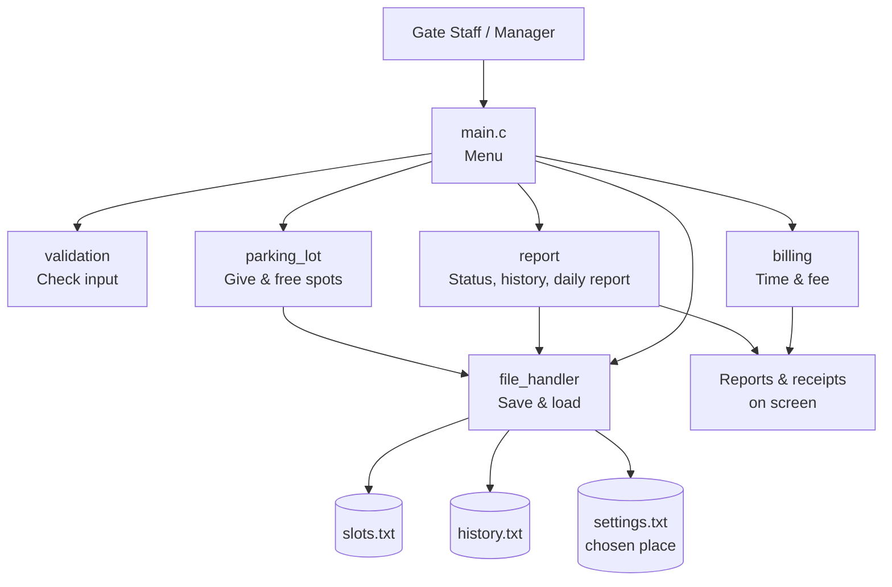
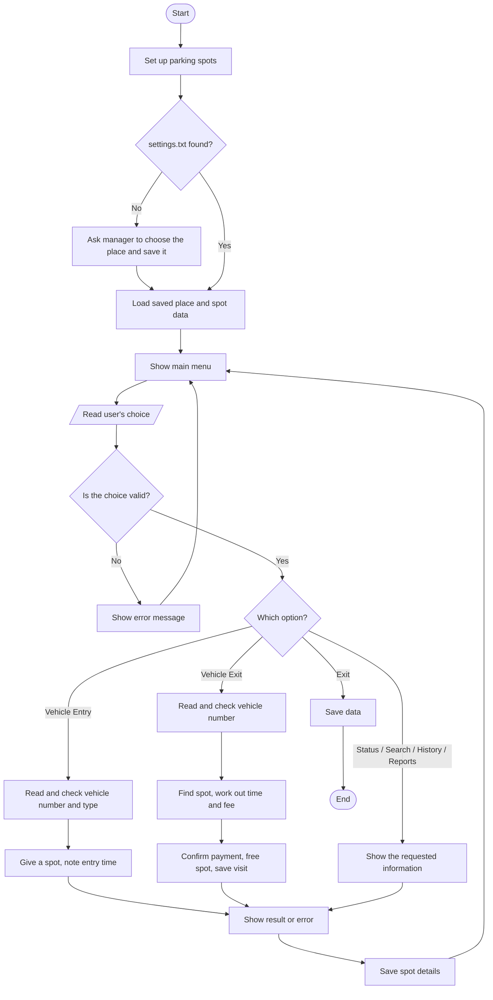

# Project Proposal: Smart Parking Management System with Slot Allocation and Billing

> Phase 1 – C Programming and Software Engineering Mini Project

---

## 1. Project Information

### 1.1 Project Title

**Smart Parking Management System with Slot Allocation and Billing**

### 1.2 Engineering Domain

Automotive / Transportation

### 1.3 Team Details

| Field                  | Details                                                    |
|------------------------|------------------------------------------------------------|
| Student name           | Janhavi Ghose                                              |
| Roll number / MIS      | [Enter roll number]                                        |
| Division / batch       | [Enter division / batch]                                   |
| Repository name        | smart-parking-management-system                            |
| GitHub repository link | [https://github.com/<username>/smart-parking-management-system] |

### 1.4 Individual Project Declaration

I confirm that this project is my individual work. I understand the design, source code, unit tests, Makefile and documentation in this repository, and I am ready to explain or change any part during evaluation.

Student signature or acknowledgement: [Enter acknowledgement]

---

## 2. Engineering Scenario

### 2.1 Scenario Description

**Where this happens:** Paid parking lots at malls, hospitals, offices, railway stations and colleges. Each lot has a fixed number of parking spots. Some spots are for two-wheelers and some are for four-wheelers. There is one entry gate and one exit gate.

**Who is involved:**
- **Gate staff**, who note down vehicles coming in and going out, and collect the parking fee.
- **The parking manager**, who checks how full the lot is and how much money was collected.
- **Vehicle owners**, who park and pay.

**How it is done today:** In many parking lots, the gate staff write the vehicle number and time in a register or on a paper ticket. They have to look around to find an empty spot. When the vehicle leaves, they search the register, work out how long it stayed, and calculate the fee by hand using a rate chart. At the end of the day, they add up the money by hand.

**Information that needs to be kept:**
- Which spots are empty and which are filled, and which vehicle is in each spot
- The number, type and entry time of every parked vehicle
- The exit time, time parked and fee paid for every vehicle that has left
- Daily totals: how many vehicles came and left, and how much money was collected

**Problems with the current way:**
- Finding an empty spot takes time, so a line forms at the entry gate.
- Handwriting is hard to read, and times are sometimes written wrong.
- Fees worked out by hand can be wrong or different each time.
- A spot may still show as "filled" even after the vehicle has left.
- Paper tickets get lost, which causes arguments.
- The manager cannot quickly see how full the lot is or how much was earned today.
- Old records are hard to find when there is a question or complaint.

### 2.2 Problem Statement

In paid parking lots, gate staff and parking managers find it slow and difficult to note down vehicles, find empty spots and calculate fees by hand. This leads to long lines at the gates, wrong fees, spots wrongly shown as filled, and no correct record of how full the lot is or how much money was collected. The proposed program will automatically give each vehicle an empty spot, note the entry and exit times, calculate the fee using fixed rules, save all data in files, and show simple reports, so that staff can handle vehicles faster, always charge the correct fee, and see correct information about the parking lot at any time.

### 2.3 Proposed Solution

The program is a C program that runs in a text window (no buttons or graphics). The user picks options from a numbered menu.

**What the program will do:**
- **First-time setup:** The manager chooses what kind of place the parking lot is for: **Mall, Supermarket, Office or Event (pandal)**. Each place has its own fee rules, chosen to encourage the right behaviour (for example, a mall makes long stays cheap so people shop longer, while a supermarket makes long stays costly so spots are free for the next shopper). The choice is saved and used every time the program runs.
- **At the entry gate:** The staff types the vehicle number and chooses the vehicle type. The program checks that the number is written correctly and that this vehicle is not already inside. It then gives the first empty spot for that vehicle type and notes the entry time.
- **At the exit gate:** The staff types the vehicle number. The program finds the vehicle's spot, notes the exit time, and works out how long the vehicle stayed and how much it must pay. After the staff confirms the payment, the spot becomes empty again, and the visit is saved in a history file.
- **For the manager:** The program can show which spots are empty or filled, find a parked vehicle, show the past visits of a vehicle, show a daily report, and list vehicles parked for too long.

**How it solves the problem:** The program finds spots, notes times and calculates fees by itself, so there is no searching or hand calculation. All data is saved in files, so nothing is lost and old records are easy to find.

**Information it will keep:**
- For each **spot**: spot number, vehicle type, empty or filled, which vehicle is in it, and entry time.
- For each **completed visit**: vehicle number, vehicle type, spot number, entry time, exit time, time parked and fee paid.

**Important calculations and decisions:**
- Choosing the first empty spot of the right type
- Refusing entry if the vehicle number is wrong, if the vehicle is already inside, or if there is no empty spot
- Working out the time parked, even if the vehicle stays past midnight
- Working out the fee using these rules:
  - The first few minutes are free.
  - There is a fixed first charge that covers the first few hours.
  - Every extra hour, or part of an hour, has an extra charge.
  - There is a maximum charge for one day.
  - Two-wheelers and four-wheelers have different rates.
  - All these numbers depend on the place chosen (Mall, Supermarket, Office or Event).
- Finding vehicles that have been parked for too long

**What the program will show:**
- A receipt at exit: vehicle number, spot, entry time, exit time, time parked and fee
- A list of all spots showing empty or filled, with counts for each vehicle type
- The past visits of one vehicle
- A daily report: number of vehicles in and out, total money collected, money from each vehicle type, and the average time parked
- A list of vehicles parked for too long

### 2.4 Target Users

| User Type | Responsibility | How the User Will Use the Application |
|-----------|----------------|---------------------------------------|
| Gate staff / security guard | Uses the program every day at the gate. Notes vehicles coming in and going out, collects fees | Uses "Vehicle Entry", "Vehicle Exit", "Spot Status", "Search Vehicle", "Vehicle History" and "Overstay List". Reads the spot number and fee shown on the screen. Cannot open manager-only options |
| Parking manager / installer | Sets up the program the first time, checks the money collected, changes the place type if needed | Chooses the place type on the first run. Enters the manager PIN to open "Daily Report" and "Change Place Type" |
| Vehicle owner (does not use the program directly) | Parks and pays | Gets a spot number at entry and the receipt details at exit |

---

## 3. Project Scope

### 3.1 In-Scope Features (what the program WILL do)

1. Keep a fixed number of spots, with separate spots for two-wheelers and four-wheelers
2. Check that the vehicle number is in the correct Indian format (example: MH12AB1234)
3. Give the first empty spot of the right type when a vehicle enters
4. Stop the same vehicle from entering twice
5. At exit, work out the time parked and the fee, then free the spot
6. Use fee rules: free minutes, first charge, extra-hour charge, daily maximum, different rates for each vehicle type
7. Let the manager choose the type of place (Mall, Supermarket, Office, Event), and use the fee rules for that place
8. Show all spots as empty or filled, with counts
9. Find a parked vehicle using its number
10. Show the past visits of a vehicle
11. Show a daily report of vehicles and money collected
12. Show vehicles parked for too long (the limit depends on the place)
13. Save and load all data using text files
14. Protect manager-only options (Daily Report, Change Place Type) with a simple manager PIN
15. Check all inputs and show a clear message if something is wrong, without the program crashing

### 3.2 Out-of-Scope Features (what the program will NOT do)

1. Read number plates using a camera
2. Take online or card payments (payment is only confirmed by the staff)
3. Have a graphical screen with buttons, or a mobile app
4. Connect to real hardware like gates, sensors or ticket printers
5. Let people book a spot in advance
6. Handle more than one parking lot
7. Offer monthly passes or discounts
8. Real user accounts, passwords or secure logins (only one simple manager PIN is used)

### 3.3 Assumptions

1. There is only one parking lot, and only one person uses the program at a time.
2. The number of two-wheeler and four-wheeler spots is fixed.
3. Entry and exit times are taken from the computer's clock, and the clock is correct.
4. Every vehicle is either a two-wheeler or a four-wheeler.
5. Vehicle numbers follow the normal Indian format.
6. Payment is collected in cash or outside the program, and the staff only confirms it in the program.
7. All money is in rupees and rounded to whole rupees.
8. The fee rules for each place are fixed in the program. The manager can only choose the place, not type in new rates.
9. The place can only be changed when no vehicle is parked, so that every vehicle is charged by the rules that were active when it entered.
10. The first run of the program is done by the manager or installer. After that, the program is used every day by the gate staff.
11. The manager PIN is a fixed number written in the program. It keeps the gate staff away from manager options, but it is not real security (known limitation).

### 3.4 Constraints (limits on the project)

1. The program runs only in a text window (command line).
2. Data is saved in simple text files, not in a database.
3. There is a fixed maximum number of spots and history records.
4. It must be written in C, build using a Makefile, and show no compiler warnings.
5. Tests must be written using Google Test (gTest).
6. It must be done alone, within the course time.

---

## 4. Requirements

### 4.1 Functional Requirements (what the program must do)

| ID | Functional Requirement | Priority | Verification Method |
|----|------------------------|----------|---------------------|
| FR-01 | The system shall load the spot details from the saved file when the program starts. | High | Demonstration / Test |
| FR-02 | The system shall check that the vehicle number is in the correct format. | High | Test |
| FR-03 | The system shall give the first empty spot of the correct type to an entering vehicle and note the entry time. | High | Demonstration / Test |
| FR-04 | The system shall refuse entry if the same vehicle is already parked. | High | Test |
| FR-05 | The system shall tell the staff when no empty spot is available for that vehicle type. | High | Test |
| FR-06 | The system shall find the vehicle's spot at exit and note the exit time. | High | Demonstration / Test |
| FR-07 | The system shall work out how long the vehicle was parked. | High | Test |
| FR-08 | The system shall work out the fee using the fee rules for the chosen place and the vehicle type. | High | Test |
| FR-09 | The system shall free the spot and save the visit in the history file after the payment is confirmed. | High | Demonstration / Test |
| FR-10 | The system shall show all spots as empty or filled, with counts for each vehicle type. | Medium | Demonstration |
| FR-11 | The system shall find a parked vehicle by its number and show its spot and entry time. | Medium | Demonstration / Test |
| FR-12 | The system shall show the past visits of a vehicle. | Medium | Demonstration |
| FR-13 | The system shall show a daily report of vehicles in and out, money collected, and average time parked. | Medium | Demonstration / Test |
| FR-14 | The system shall list vehicles parked longer than the allowed time. | Low | Demonstration / Test |
| FR-15 | The system shall save the spot details to file after every entry and exit. | High | Demonstration |
| FR-16 | The system shall refuse wrong menu choices and wrong inputs with a clear message, and keep running. | High | Test |
| FR-17 | The system shall let the manager choose the type of place (Mall, Supermarket, Office, Event) and save this choice. | High | Demonstration / Test |
| FR-18 | The system shall allow the place to be changed only when no vehicle is parked. | Medium | Test |
| FR-19 | The system shall ask for the manager PIN before opening "Daily Report" or "Change Place Type", and refuse access if the PIN is wrong. | Medium | Test |

### 4.2 Non-Functional Requirements (how well the program must work)

| ID | Non-Functional Requirement | Verification Method |
|----|----------------------------|---------------------|
| NFR-01 | The code shall compile without any warnings. | Build output |
| NFR-02 | The code shall be split into several files, each doing one job. | Code review |
| NFR-03 | The program shall not crash when the user types something wrong. | Negative testing |
| NFR-04 | Important functions shall be tested using gTest. | Unit-test output |
| NFR-05 | The project shall be built using a Makefile. | Build demonstration |
| NFR-06 | The project shall be kept on GitHub. | Repository review |
| NFR-07 | No data shall be lost when the program is closed and opened again. | Demonstration |
| NFR-08 | The program shall not crash if a data file is missing, empty or damaged. | Negative testing |
| NFR-09 | Fee rates, number of spots and other limits shall be kept as named values in one place, so they are easy to change. | Code review |
| NFR-10 | Every action shall show a clear success or error message. | Demonstration |
| NFR-11 | The code shall use clear names, neat formatting and helpful comments. | Code review |

### 4.3 Requirement Traceability (which part of the code handles each requirement)

*Test numbers match the unit-test plan in `docs/detailed_design.md`, section 13. A dash (–) means the requirement is checked by demonstration, not by a unit test.*

| Requirement ID | Module | Function or Feature | Test ID |
|----------------|--------|---------------------|---------|
| FR-01 | file_handler | loadSlots(), loadSettings() | UT-36, UT-37, UT-38 |
| FR-02 | validation | isValidVehicleNumber(), normalizeVehicleNumber() | UT-01 – UT-07 |
| FR-03 | parking_lot | allocateSlot() | UT-26, UT-29 |
| FR-04 | parking_lot | allocateSlot(), findVehicleSlot() | UT-27 |
| FR-05 | parking_lot | allocateSlot() (lot full) | UT-28 |
| FR-06 | parking_lot | findVehicleSlot() | UT-30, UT-31 |
| FR-07 | billing | calculateDurationMinutes() | UT-23, UT-24, UT-25 |
| FR-08 | billing | calculateFee() | UT-14 – UT-22 |
| FR-09 | parking_lot, file_handler | releaseSlot(), appendHistoryRecord() | UT-32, UT-33, UT-39 |
| FR-10 | report | printSlotStatus() | – |
| FR-11 | parking_lot | findVehicleSlot() | UT-30, UT-31 |
| FR-12 | file_handler, report | loadHistory(), printVehicleHistory() | UT-39 |
| FR-13 | report | calculateDailySummary() | UT-40, UT-41 |
| FR-14 | billing, report | isOverstay(), findOverstayVehicles() | UT-42 |
| FR-15 | file_handler | saveSlots() | UT-36 |
| FR-16 | validation, main | parseMenuChoice() | UT-08, UT-09, UT-10 |
| FR-17 | parking_lot, file_handler | changePlaceType(), saveSettings() | UT-34 |
| FR-18 | parking_lot | changePlaceType() | UT-35 |
| FR-19 | validation | isValidManagerPin() | UT-11, UT-12, UT-13 |

---

## 5. High-Level Architecture

### 5.1 Architecture Description (how the program is organised)

The program is split into separate parts called **modules**. Each module is in its own `.c` file, with a matching `.h` file, and does one job:

- **`main.c` – the menu:** Starts the program, loads the saved data, shows the menu, reads the user's choice and calls the right module. It does not do any calculations itself.
- **`validation` – checking input:** Checks that the vehicle number, vehicle type and menu choice are correct before they are used.
- **`parking_lot` – managing spots:** Gives a spot, finds a vehicle, frees a spot, and counts empty and filled spots.
- **`billing` – working out money:** Keeps the fee rules for each place, and works out the time parked and the fee.
- **`file_handler` – saving and loading:** Reads and writes the chosen place, the spot details and the history to text files, and checks that every file action worked.
- **`report` – showing information:** Shows spot status, vehicle history, the daily report and the overstay list.

Every module returns a **status code**, a number that says whether the action worked or what went wrong. This way all errors are handled the same way.

### 5.2 Architecture Diagram

*(An image version will be saved as `docs/architecture.png`.)*

### 5.3 High-Level Workflow (what happens from start to end)

**Main menu:**
1. Vehicle Entry
2. Vehicle Exit
3. View Spot Status
4. Search Parked Vehicle
5. View Vehicle History
6. Daily Report (manager PIN needed)
7. Overstay List
8. Change Place Type (manager PIN needed, only when the lot is empty)
0. Save and Exit

---

## 6. Initial Modules

| Module Name | Source File | Header File | What It Does |
|-------------|-------------|-------------|--------------|
| Main application | main.c | Not applicable | Starts the program, loads data, shows the menu, calls other modules, saves data and exits |
| Validation | validation.c | validation.h | Checks vehicle numbers, vehicle types, menu choices, the manager PIN and numbers typed by the user |
| Parking lot | parking_lot.c | parking_lot.h | Sets up the spots; gives, finds and frees spots; counts empty and filled spots |
| Billing | billing.c | billing.h | Keeps the fee rules for each place; works out the time parked and the fee |
| File handler | file_handler.c | file_handler.h | Saves and loads the chosen place, spot details and history; handles file errors |
| Report | report.c | report.h | Shows spot status, vehicle history, daily report and overstay list |
| Common definitions | – | common.h | Shared structures, enums, status codes and fixed values used by all modules |

---

## 7. Planned C Concepts

| C Concept | Where and Why It Will Be Used |
|-----------|-------------------------------|
| Functions | Each job (check input, give spot, work out fee, save data) is a separate function, so each one can be tested on its own |
| Structures | `ParkingSlot_t` keeps the details of one spot. `ParkingRecord_t` keeps the details of one finished visit. `DailySummary_t` keeps the totals for the daily report |
| Enumerations (enum) | Named choices instead of plain numbers: place type (mall, supermarket, office, event), vehicle type (two-wheeler, four-wheeler), spot status (empty, filled) and status codes (success, invalid input, lot full, not found, file error) |
| Arrays | All the parking spots are kept in an array. The fee rules for the four places are kept in a fixed table (array). History records are read into an array to make reports |
| Strings | Vehicle numbers and spot numbers are stored as strings and checked using `<string.h>` functions |
| Pointers | Structures are passed to functions using pointers, so the function can change them directly without making a copy |
| Constants | Number of spots, fee rates, free minutes, overstay limit and file names are written once as named values (`#define`) instead of plain numbers in the code |
| File handling | `fopen`, `fgets`, `fprintf`, `sscanf` and `fclose` are used to read and write the data files. Every file action is checked to see if it worked |
| Time handling | `time()`, `difftime()` and `strftime()` from `<time.h>` are used to get the current time, work out the time parked and print times neatly |
| Status codes | Every module function returns a status code, so the program knows what went wrong and shows the right message instead of crashing |
| Dynamic memory (malloc) | Not used, because the number of spots is fixed. Fixed-size arrays are simpler and safer here |
